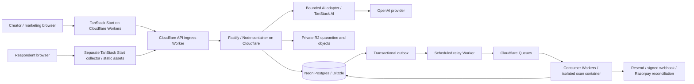

# Technical foundation

**Revised:** 28 October 2026. **Status:** User-selected platform direction, with deployment/auth integration gates still pending. No production application is implemented. Official sources checked for this revision; pin exact compatible versions and image digests at scaffold time.

## 1. Architecture and deployment decision

Use a **TypeScript modular monolith** in a pnpm workspace. All frontend applications use **React + TanStack Start**, including the creator application, public collector and marketing/help surfaces. TanStack Router, Query and Form provide their respective application layers. Vite is Start's build tool, not a competing frontend framework. The collector stays a separate deployment and bundle; use prerendering/client rendering where appropriate and exclude authenticated editor code from it.

**Cloudflare is the first deployment choice.** TanStack Start runs on Workers with static assets. The selected Fastify deployment is a full Node.js Docker image on **Cloudflare Containers**, reached through an ingress Worker. Queue consumers and scheduled handlers run on Workers. Neon supplies managed PostgreSQL; R2 supplies private object storage. AWS is the documented fallback for workloads that fail Cloudflare's deployment or operating gates.



One repository and shared domain packages remain the baseline. Ingress proxies HTTP and preserves webhook bytes, streaming, headers and cancellation; it does not become a second policy engine. The API still authorizes every operation. No business write is implemented independently in a Start server function. Start functions can handle rendering/session lookups and delegate business commands to Fastify. Do not cache sessions, answers or tenant results at the edge.

Follow-up evaluation: [Express on Node/Workers versus Bun](10-express-node-bun-comparison.md) records a successful local Express/Workers probe and a potential alternative. This comparison does not change the current Fastify selection.

### Why Containers for Fastify

Cloudflare documents Node HTTP bridging through `httpServerHandler`, but Workers prohibits dynamic string evaluation. A local spike with **Fastify 5.12.7, Wrangler 4.154.0 and workerd 1.20261023.1** started the Worker after deferring Fastify readiness to a request, then failed because Fastify's router used `new Function`; AJV compilation also encountered the restriction. The same routes/plugins passed under ordinary Node. Therefore an unmodified Fastify/plugin stack is **not** our direct-Workers deployment baseline. This is a result for the tested setup, not a proof that every custom build/adapter fails. Do not patch runtime security or maintain router/compiler forks just to preserve the deployment label.

[Local evidence](evidence/fastify-cloudflare-compat/worker-result.txt), [Cloudflare HTTP bridge](https://developers.cloudflare.com/workers/runtime-apis/nodejs/http/#httpserverhandler), [Workers web standards](https://developers.cloudflare.com/workers/runtime-apis/web-standards/), [Fastify validation](https://fastify.dev/docs/latest/Reference/Validation-and-Serialization/).

A Cloudflare Container runs a conventional Node server and supports libraries needing that runtime. Cloudflare's current scaling guide requires deliberate instance routing/lifecycle management; do not assume automatic managed replica scaling. Validate container availability, cold starts, warm capacity, placement near Neon, instance replacement and rolling deployment before committing public intake to it. If these fail our targets, move **that workload** to AWS ECS/Fargate while retaining Cloudflare frontend/edge services. See [platform decision](09-platform-stack-decision.md) and [ADR-011](decisions/ADR-011-cloudflare-tanstack-neon-razorpay.md).

## 2. Selected stack and library inventory

| Concern | Selection | Scope / boundary |
|---|---|---|
| Language / runtime | TypeScript strict; Node.js LTS for containers, CI and tooling | Workers uses workerd, not a full Node process; pin compatibility dates separately |
| All frontend apps | React + TanStack Start + TanStack Router | Creator, marketing/help and separately deployed collector; Start uses Vite with `@cloudflare/vite-plugin` |
| Remote state | TanStack Query | API cache/mutations; request-scoped SSR clients; clear user/tenant caches on identity/workspace change |
| Input state | TanStack Form + Zod | Replaces React Hook Form; the shared engine still owns applicability and canonical validation |
| Local editor state | TanStack Store behind a small internal adapter | Replaces Zustand; currently alpha, so pin and test upgrades; use React state for component-local values |
| Tables / large lists | TanStack Table; TanStack Virtual when measured | Server cursor/filter/sort remains authoritative; virtualize only where needed |
| Interaction utilities | TanStack Pacer, Hotkeys as bounded optional modules | Currently beta; debounce/search and opt-in editor shortcuts, never billing/authorization/rate-limit authority |
| AI integration | TanStack AI + `@tanstack/ai-openai`, `@tanstack/ai-react` | Thin typed provider/stream boundary; engine validation, evidence, budgets and commits remain ours; load guided client code only on opt-in |
| Other TanStack offerings | DB, Charts, Markdown, Highlight, Devtools, CLI, Config, Intent and Redact assessed separately | Adoption/maturity table in the platform decision; do not install everything into the public collector |
| API | Fastify + Cookie, CORS, Helmet, Swagger plugins | Full Node container; REST/OpenAPI and trusted static schemas |
| Contracts | Zod 4 + JSON Schema export | Versioned form DSL and request/events; never compile arbitrary customer schemas as code |
| Database | Neon managed PostgreSQL + Drizzle ORM / Drizzle Kit | `pg` pool in Node containers; `pg` via Hyperdrive for database-using Workers; migrations from a controlled release job |
| Alternative database transport | `@neondatabase/serverless` + matching Drizzle driver | Only if selected by transport spike; HTTP reads/batched transactions are not an interchangeable interactive transaction connection |
| Identity | Better Auth + official Drizzle adapter, sessions in Neon | Recommended replacement for removed hosted auth; verification, reset, OAuth, TOTP and revocation must pass integration/security gates |
| Object storage | Cloudflare R2 private buckets | Native bindings in Workers; S3-compatible API in containers; AWS S3 fallback through storage interface |
| Object SDK / signing | AWS SDK v3 S3 client / presigner in Node; native R2 bindings and `aws4fetch` in Workers where needed | Short-lived scoped upload/download capability; signing does not make uploaded content trusted |
| Durable background delivery | Cloudflare Queues + Cron Triggers + Neon transactional outbox | Replaces pg-boss daemon; queue publication is outside the Postgres transaction, repaired from retained outbox |
| UI | Tailwind CSS, owned shadcn/ui, Radix primitives, Lucide React | TanStack's headless libraries do not replace CSS or accessible primitive components |
| Font / motion | Self-hosted DM Sans Variable (OFL 1.1), native CSS | Foundation 0.2 remains the visual direction; no animation runtime needed |
| Reordering | dnd-kit with explicit Move up/down actions | No general TanStack drag-and-drop replacement selected |
| CSV / upload checks | `csv-stringify`, `file-type`; isolated ClamAV | Streaming export, formula escaping, content signature and malware checks |
| Email | Resend + React Email | Verification/reset and internal notifications; distinct senders, durable send ledger |
| SaaS billing | Razorpay Subscriptions + Standard Checkout + official `razorpay` Node SDK | Existing founder account; Snapform owns subscription-management UI; no assumption of a Stripe-style hosted portal |
| Observability | Pino in Node; structured Worker logs; OpenTelemetry where supported; Sentry Node / Cloudflare SDKs | Runtime-specific integrations; scrub answer content, credentials and session tokens |
| Tests | Vitest, Testing Library, fast-check, Playwright, axe-core, k6 | Add `@cloudflare/vitest-pool-workers`/Wrangler integration for actual Worker behavior |
| Design QA | Storybook | Component states and journey accessibility; no automatic compliance guarantee |
| Build / delivery | pnpm workspaces, ESLint, Prettier, GitHub Actions, Wrangler, Docker | Lockfiles and image digests; linux/amd64 container image; explicit release/migration jobs |

TanStack Start has an official Cloudflare guide. Form supports application form state, and Table is headless; styling and the domain form engine remain separate responsibilities. TanStack Store/DB/Pacer/Hotkeys maturity differs from Start/Query/Form, so wrappers and selective adoption are deliberate. [Start deployment](https://developers.cloudflare.com/workers/framework-guides/web-apps/tanstack-start/), [official ecosystem catalog](https://tanstack.com/libraries), [Form](https://tanstack.com/form/latest/docs/overview), [Table](https://tanstack.com/table/latest/docs/overview).

TanStack AI's OpenAI adapter and React client are selected for the TanStack preference, subject to a compatibility gate for structured results, refusals, output limits, usage accounting, cancellation and non-storage controls. If an adapter cannot preserve required provider controls, keep the official provider SDK behind the same server interface; never silently relax policy. Experimental agent/workflow features are not needed for V1. [TanStack OpenAI adapter](https://tanstack.com/ai/latest/docs/adapters/openai).

Better Auth has official TanStack Start, Fastify and Drizzle integration documentation. Prefer one auth authority mounted at Fastify's auth boundary, exposed under the creator's same-origin API path. Start reads the authenticated session through that boundary; it must not treat a client route guard as authorization. Use the current official adapter package (`@better-auth/drizzle-adapter` in checked docs), not an unverified community Cloudflare wrapper. Password hashing CPU/memory, multiple Set-Cookie headers, callbacks, MFA and recovery are early feasibility work. [TanStack integration](https://better-auth.com/docs/integrations/tanstack), [Fastify integration](https://better-auth.com/docs/integrations/fastify), [Drizzle adapter](https://better-auth.com/docs/adapters/drizzle).

**Licensing/version gate:** capture versions/licenses in an SBOM, audit transitive dependencies, and test the selected combination. Font package is `@fontsource-variable/dm-sans@5.3.0`. Spike package versions are reproducibility evidence, not automatic production pins. No Supabase, Stripe, Next.js, React Hook Form or Zustand dependency is selected.

## 3. Services, operating gates and fallback

| Workload | Cloudflare-first / selected service | Gate and fallback |
|---|---|---|
| Frontend SSR and assets | TanStack Start on Workers + static assets/CDN | Separate web/collector deployments; official Vite plugin; if blocked, containerized Start on AWS |
| API | Fastify Node image on Cloudflare Containers behind ingress Worker | Prove idle-start latency, health routing, placement, fixed capacity/scaling, rollouts, quotas and failure recovery; AWS ECS/Fargate if inadequate |
| Database | Neon production and isolated staging/preview branches | Dedicated non-owner roles, paid restore retention, connection budgets, migration role; Neon stays selected even if compute moves to AWS |
| Worker database access | Hyperdrive → Neon, caching disabled for authoritative data | Transaction-mode connection discipline and tenant isolation; alternative Neon WebSocket transport only after equivalent transaction tests |
| Auth | Better Auth on API runtime + Neon identity tables | Auth feature/security tests and Resend mail; adding external managed identity requires a separate recorded decision |
| Objects | Private R2; quarantine and clean namespaces/buckets | Short-lived capabilities, strict CORS, immutable object IDs; S3 adapter if R2 constraint is established |
| Queues / scheduled work | Queues consumers and Cron relay/reconciliation | DLQ, dedupe, next-attempt records, bounded fan-out; an AWS fallback must replace both relay/consumer adapters deliberately |
| Native file scanner / backup tools | Isolated Cloudflare Container | Maintained ClamAV signatures, constrained resources and outbound access; `pg_dump`/restore jobs run in controlled containers; AWS Fargate for these jobs if unsupported |
| DNS / abuse | Cloudflare DNS/WAF + Turnstile | Validate challenge server-side; API enforces budgets if edge is bypassed |
| Email / AI / billing | Resend / OpenAI via bounded adapter / Razorpay | Separate environment keys, provider limits and verified event handling; no silent vendor switch |
| Recovery copies | Separate-account protected R2 bucket by default | Verify retention locks and write/read/delete separation; choose independent AWS S3 copy if disaster scenario requires provider independence; no assumption of full S3 versioning parity |
| Monitoring / deploy | Sentry + external uptime/status; GitHub Actions + Wrangler + Docker | Independent alert path; preview/test/live separation; deploy and roll back a known artifact |

Neon is the database provider; **TanStack DB is a client collection library**, and neither D1 nor Durable Object storage replaces Neon business records. Durable Objects may coordinate container routing, not become a second source of response truth. Hyperdrive is a connection accelerator, not the database. Its query cache does not automatically invalidate after writes, so disable query caching for sessions, permissions, entitlements and other authoritative data. [Neon from Workers](https://developers.cloudflare.com/workers/databases/third-party-integrations/neon/), [Drizzle/Hyperdrive](https://developers.cloudflare.com/hyperdrive/examples/connect-to-postgres/postgres-drivers-and-libraries/drizzle-orm/), [Hyperdrive behavior](https://developers.cloudflare.com/hyperdrive/concepts/how-hyperdrive-works/).

In containers use a bounded `pg` pool with Neon pooling as configured; budget max instances × pool size and leave migration/recovery headroom. In Workers create/close a client within the request or queue invocation using Hyperdrive. Interactive submit/tenant transactions must use one connection throughout; do not stitch a transaction across unrelated HTTP queries. Choose one verified transport per runtime; do not stack Hyperdrive and a serverless driver merely because both exist.

Cloudflare frontend execution is distributed, but Neon and container instances have physical location and latency. Prefer a Neon region near pilot traffic, then verify actual compute-to-database latency, cold-start behavior and data paths. A global edge does not guarantee globally local database access or end-to-end residency. [Containers deployment](https://developers.cloudflare.com/containers/get-started/), [routing/lifecycle](https://developers.cloudflare.com/containers/configuration/scaling-and-routing/).

The founder already has a Razorpay account. Use it; do not repeat provider selection or require a new account. At T03 confirm its test/live Subscription configuration, methods, charge currency and intended customer markets, then run test-mode checkout/renewal/cancel/refund scenarios. These are integration gates, not an assertion that an account is missing. [Subscriptions integration](https://razorpay.com/docs/payments/subscriptions/integration-guide/).

## 4. Canonical form and engine contract

One versioned definition contains stable field/option/page/rule IDs, type/constraints, safe presentation, applicability/routing, endings, theme reference, locale, public business notice and AI policy. Server-only secrets, private policies and connection credentials never enter the public manifest. V1 has no private scoring; any future confidential rule must remain server-side.

Definitions are input programs in a bounded DSL, not arbitrary executable schemas. Initial limits: 50 answer fields, 10 pages, 30 rules, expression depth 4, 20 choice options per field and 256KB definition JSON. Exceeding a limit is a clear validation error. Revisit these based on real forms, not a parity arms race.

Engine evaluation order:

1. Decode values using the pinned field codec; validate types/limits.
2. Recompute applicability/reachability from confirmed base answers until stable, with bounded passes. Permit conditions only on earlier fields/pages in V1; reject cyclic dependencies at publish.
3. Produce effective answers excluding unreachable values. Stale hidden values stay outside exports, AI context and delivery; purge per retention policy.
4. Evaluate ordered routing rules at page exit. Priority is explicit; equal-priority multiple matching navigation destinations are a publish error. No implicit mutation order.
5. Validate reachable required answers. Compute a deterministic review hash over effective answers, version and revision.
6. Server repeats evaluation at submission; only current reviewed state may commit.

Boolean `false`, number `0`, absent, blank, refused and not-applicable are explicit distinct states. Dates are ISO local dates, not silently converted to UTC instants. Budget records include an explicit ISO currency and unit; V1 does not calculate quotes.

Versioned fixtures must run in browser and server and generate identical normalized output. Definition upgrades are explicit migrations; old engine support remains available for active versions until migrated/revoked.

## 5. Data model and invariants

| Entity | Important keys/invariants |
|---|---|
| workspace, membership, invitation | Composite tenant-scoped identities; one or more active owners; invitation hash/expiry |
| form, form_draft, draft_operation | Tenant/form relationship; monotonically increasing revision; unique operation ID; CAS writes |
| form_version, publication | Immutable definition/config hash; unique form/version; atomic live pointer; explicit revoked state |
| response_session, answer_candidate, answer_state | Pins version; capability hash and expiry; state revision; candidate evidence/confirmation; applicability |
| conversation_turn, ai_run | Unique session/client turn; lease/fencing generation; model/prompt/policy versions; token/cost/outcome |
| response, submission_event, outbox_job | One response per tenant/session; reviewed snapshot, stable event/job identity; atomic outbox insert, lease and next-due time |
| connection, mapping_version, delivery_intent, delivery_attempt | Tenant scope; encrypted secret; frozen mapping/event; separate attempts and uncertain external status |
| upload, scan_job, object_copy_manifest | Tenant/session ownership; quarantine state; file hash; backup object/version linkage |
| knowledge_entry, knowledge_version | Approved immutable text snapshot; sources; active sessions pin it |
| usage_event, usage_reservation, entitlement_projection | Unique billable identity; atomic reservations/limits; rate-card/model cost version |
| subscription_event, audit_event, deletion_tombstone | Provider dedupe; sanitized append-only history; deletion suppression reapplied after restore |

Tenant-aware foreign keys prevent a response referencing another workspace's form version. JSONB holds variable definitions/answers; relational columns index workspace, form, version, status and timestamps. No table per customer form. Index `(workspace_id, form_id, created_at, id)` for cursor queries; add projections only after query evidence.

RLS is defense in depth, not the sole API authorization. Use dedicated non-owner roles without BYPASSRLS; after session/membership verification set tenant context transaction-locally on the same connection as tenant queries. Never retain tenant context across pooled requests. Auth/session tables have separately scoped grants, since login cannot depend on an already selected workspace. Migration/admin credentials never enter browser bundles or ordinary request paths. Workers validate outbox/event/tenant relationships; queue payloads carry IDs, not answer content. Hyperdrive query caching is off for these operations. Test cross-tenant access and pool reuse under both container and Worker transports. [PostgreSQL RLS](https://www.postgresql.org/docs/current/ddl-rowsecurity.html).

## 6. API and reliability contracts

| Endpoint family | Preconditions and result |
|---|---|
| `PATCH /v1/forms/:id/draft` | Membership/editor, expected revision, unique operation ID; 409 on conflict |
| `POST /v1/forms/:id/validate` | Compiles exact revision; returns issues keyed by field/rule and validation hash |
| `POST /v1/forms/:id/publish` | Expected revision/hash; transaction creates version and live pointer |
| `GET /v1/public/:slug/manifest` | Public allowlisted projection; immutable version ETag; no tenant secrets |
| `POST /v1/public/:slug/sessions` | Rate/abuse/entitlement reservation checks; returns scoped capability and pinned version |
| `PUT /v1/sessions/:id/answers/:fieldId` | Capability, request ID and state revision; validate and return authoritative state delta |
| `POST /v1/sessions/:id/turns` | Client turn ID/revision; claim lease, validate candidate output and CAS commit |
| `POST /v1/sessions/:id/submit` | Capability, idempotency key, reviewed state hash/revision, required acknowledgments |
| `GET /v1/responses` / `POST /v1/exports` | Workspace role, cursor/limits; sensitive data private/no shared cache |
| `POST /v1/deliveries/:id/retry` | Editor/owner, safe replay classification, audit; no response mutation |
| `POST /v1/billing/events` | Verify raw-body signature, persist provider event, asynchronous entitlement reconciliation |

Errors have stable code, safe message, issue IDs and request ID; never include raw tokens or SQL. Use 401/403/404 without resource enumeration, 409 revision/idempotency conflict, 422 validation and 429 with bounded retry guidance. Public session capabilities cannot access control API routes. CORS allowlists are not authorization. Define cookie CSRF/Origin checks and embed-compatible bearer capability storage during the security design spike.

**Submit transaction:** lock session → check revocation/reservation/review revision → engine validation → insert response (unique session) → insert stable business event, delivery intents and outbox jobs → insert deduplicated usage event → consume reservation → mark submitted → commit → return durable response ID. All these database writes commit together. No external API or queue publication is inside this transaction.

**Outbox relay:** scheduled Worker claims a bounded batch of due outbox rows using a lease/fencing token and commits the claim. It publishes IDs to Cloudflare Queues outside the database transaction, then marks dispatched after queue acknowledgment. Crash after publish but before marking can duplicate a queue message; consumers dedupe stable job/event identities. Crash before publish leaves a lease that expires for recovery. A one-minute scheduled sweep is the safety net; an optional post-commit dispatch hint can reduce latency but is not the durability mechanism. Queue outage does not erase committed responses or jobs.

**Consumer/reconciliation:** check tenant, current deletion state and job lease; perform bounded work; persist result before acknowledging the queue. Cloudflare Queues is at least once. Messages may duplicate or arrive out of order; do not treat FIFO or queue acknowledgment as a remote business receipt. Exhausted transport retries route to DLQ and alert. Business `next_attempt_at` remains in Neon, so long retry schedules and recovery after queue retention expiry can be rebuilt without recreating submissions or billing usage. Do not run a pg-boss polling daemon in a Worker or rely on `waitUntil()` for durable delivery. [Queue delivery guarantees](https://developers.cloudflare.com/queues/reference/delivery-guarantees/), [queue limits](https://developers.cloudflare.com/queues/platform/limits/).

**Delivery:** claim attempt with lease/fencing; deliver outside DB transaction; persist acknowledgment. Stable event/mapping identity survives retries. Proposed schedule: immediate, 1m, 5m, 30m, 2h, 8h, 24h with jitter. Enforce HTTP timeout/bytes, SSRF checks and no redirects; bounded Retry-After; permanent config errors pause. Unknown external outcomes require reconciliation, not blind replay. Receiver dedupes event ID; universally exactly-once external effects are not promised.

**Razorpay:** verify `X-Razorpay-Signature` against the original raw body using HMAC-SHA256 and the environment's webhook secret. Dedupe `x-razorpay-event-id` and business resource transitions; do not assume ordered events or trust a browser Checkout success callback as final entitlement proof. Keep subscription creation/retry operation IDs and reconcile uncertain provider outcomes before creating another subscription. Snapform exposes its own owner billing management UI for status, receipts/invoices as available, renewal/cancellation and grace. No Stripe portal is assumed. Resend's provider idempotency window remains separate from our durable send ledger. [Razorpay verification](https://razorpay.com/docs/webhooks/validate-test/), [Resend keys](https://resend.com/docs/dashboard/emails/idempotency-keys).

## 7. AI policy and model selection

Start with one provider and a thin TanStack AI adapter; keep budget, evidence and commit policy in our domain layer. Benchmark **GPT-6 Luna** for bounded extraction/FAQ and **GPT-6.1 Sol** for draft generation/edits; these are candidate defaults, not an assertion of task fitness. Select the cheapest candidate that meets the same quality and latency gates; no automatic escalation from a cheap model to an expensive model without budget reservation. Record an immutable available snapshot ID where offered; otherwise record alias/date/config and rerun canary evals to detect upstream changes. [Model catalog](https://developers.openai.com/api/docs/models).

Use strict structured outputs and server semantic validation. Check refusal, truncation, empty output and unsupported schema paths. Provider schema restrictions are not the product DSL; generate a compatible model-facing schema adapter and test it. Structured output does not prove factual correctness. [Structured outputs](https://developers.openai.com/api/docs/guides/structured-outputs).

Turn sequence: reserve worst-case spend → claim short per-session lease/fencing token → read pinned state → call provider with bounded context outside transaction → validate candidates/knowledge support → CAS commit turn and accepted candidate state → reconcile actual cost/release remainder. A crash expires the lease; a stale run cannot overwrite a newer one. Duplicate client turn retrieves prior state, not a new billable call where recovery can determine prior completion.

Initial hard limits from FR-31 plus **$0.15 maximum provider spend/session** and an owner/workspace monthly cap. The monetary limit may terminate before token limits for a selected model. Reserve before dispatch to prevent concurrent overspend, including hidden/reasoning billable tokens where relevant. Enforce one active turn/session, two active AI sessions/workspace initially and bounded global concurrency; make fair queuing explicit.

Use `store:false` for Responses, own bounded conversation state, and no provider file/vector/agent persistence in V1. This does not by itself imply zero retention: abuse-monitoring and feature/model-specific data rules remain separate. Document actual provider processing and contractual settings. Never promise zero retention or residency based only on a request parameter. [OpenAI data controls](https://developers.openai.com/api/docs/guides/your-data).

## 8. Non-functional release targets

Every value is a **target to test**, not a measured result or customer SLA. Baseline design load: 100 paid workspaces; 100,000 submitted records/month; 200 concurrent standard sessions; 20 durable submits/second sustained for 30 minutes, burst 50/second for 60 seconds; 10 simultaneous AI calls under provider quota. Form fixture: 20 fields, 5 rules, no media in initial render. Test 50-field maximum separately. Responses retained for load tests: 1 million synthetic records across tenants; file/AI workloads tested independently and together.

| ID / dimension | Target and measurement | Release evidence |
|---|---|---|
| NFR-01 Collection availability | ≥99.9% over rolling 30 days; collection journey synthetic every minute plus server good-request ratio; include deploy failures | 14-day beta soak and monitoring; ongoing error budget ~43.2m/30 days, internal target only |
| NFR-02 Standard performance | p95 usable form ≤2s on agreed mid-range Android/4G profile; field interaction INP p75 ≤200ms; CLS p75 ≤0.1 | Real-device/lab profile documented; RUM without answer content |
| NFR-03 Submit performance | p95 durable acknowledgment ≤800ms at baseline load, uploads/AI/delivery outside critical path | k6 report including p99 and errors; server processing plus separately labeled end-to-end latency |
| NFR-04 AI latency | p95 first useful validated response ≤3s; visible fallback by 8s; UI always allows immediate switch | Provider/cold/warm profiles, timeout tests, no fake progress percentages |
| NFR-05 Durability | No acknowledged response lost in tested crash scenarios; repeated submit returns one response | Failure injection around commit/enqueue/ack; restore validation |
| NFR-06 Recovery | Database RPO ≤5m with PITR; uploads RPO ≤1h with copies; RTO ≤4h for restore+service recovery | Timed representative isolated restore; include missing recent objects in customer recovery policy |
| NFR-07 Accessibility | WCAG 2.2 AA target for creator and respondent; all core journeys keyboard/screen-reader usable | Automated checks plus VoiceOver/Safari and NVDA/Chrome manual review |
| NFR-08 Security | No unresolved critical/high launch findings in scoped review; zero cross-tenant accesses in defined corpus | Independent application/security review, tenant tests, secret scan; not a claim of zero vulnerabilities |
| NFR-09 Delivery | ≥99% eligible healthy-destination events acknowledged ≤5m; provider outages reported separately | Attempt/latency metrics, deliberate timeout/429/token-expiry/replay tests |
| NFR-10 Privacy | No raw content/secrets in operational analytics; active purge ≤7d; declared retention jobs monitored | Log sampling, deletion drills, restore tombstone verification |
| NFR-11 Maintainability | Strict TS, deterministic engine, backward fixtures, reviewed migrations, reproducible deploy | CI lint/type/build/tests, contract diff check, rollback rehearsal |
| NFR-12 Cost isolation | Hard per-session/workspace budgets and bounded file/queue resource use; no duplicate usage billing | Concurrent reservation tests and reconciled provider ledger |

WCAG is a conformance target requiring component and journey evidence; using a component library is insufficient. [W3C WCAG 2.2](https://www.w3.org/TR/WCAG22/).

**SLO response:** collect errors, queue age, AI budget exhaustion, auth failures, object scan backlog and export saturation. Alert if synthetic submit fails twice consecutively, 5xx >2% for 5m with sufficient volume, oldest eligible delivery >5m, or budget reservation reconciliation stalls. Low-volume synthetic failures still page. During rapid error-budget burn freeze risky deploys and disable AI/nonessential workers before compromising collection.

## 9. Security, privacy and recovery design

- CSP, escaped text, allowlisted URLs and image types; no arbitrary HTML/CSS/JS, no content-based eval. Webhook SSRF defense blocks private/link-local/metadata IPs on every resolution/connection, pins permitted addresses through a hardened egress path, rejects redirects and enforces timeout/bytes limits.
- Encrypt provider credentials with a key outside the database; rotate with overlap and audit. Client bundles contain only public keys/manifest. Scrub cookies, Authorization, capabilities, email and answer content from traces.
- Auth verifies identity; each API/worker/file/export authorizes workspace and role. Rate limits partition tenant/form/IP; trust proxy/IP only from known edge. API origin also enforces controls if edge is bypassed.
- File quarantine and scanner isolated from API privileges. Outage means pending, never bypass. Threat tests include disguised files, parser exhaustion, stale signed URLs and deletion races.
- Keep content out of metric dimensions; no session replay on respondent pages. Essential transactional counters use first-party server events. Public form owner is responsible for collection purpose/notice; platform supplies tools and contract review, not automatic compliance.
- Backups: Neon plan with configured PITR history plus protected exports; private file copies hourly with content hashes/version manifest; quarterly timed restore and prelaunch drill; restore into isolated environment; reapply deletions before opening traffic. RPO/RTO promises require actual measured procurement and drill results.
- Separate dev/staging/production identities, data, keys and billing. Previews never use customer data. Production migrations use expand/contract; app rollback must tolerate previous and new schema. Backups do not replace a reversible migration plan.

## 10. Verification and release evidence

Use tests where failure has real consequence. Engine fixture corpus ≥100 paths plus property tests; tenant negative matrix for routes/jobs/files/exports; integration tests use real Neon-compatible Postgres/RLS/outbox transactions plus Cloudflare queue integration, not just mocked repositories; browser tests cover authoring→publication→mobile→response→delivery and interruption/retry. [Playwright](https://playwright.dev/docs/intro).

AI gates: ≥100 representative authoring briefs, ≥300 labeled extraction/correction cases, ≥100 supported/unsupported/adversarial knowledge questions. Hold out at least 30% from prompt tuning. Report counts, types and uncertainty by cohort. Targets: 100% final proposal schema/reference validity after allowed repair; ≥95% supported-brief task success by human rubric; ≥98% exact normalized match for unambiguous extraction cases; zero unsupported consequential business claims or unconfirmed critical values committed in release corpus. Require abstention tests, including successful abstention on unsupported questions; measure supported-question answer coverage (initial target ≥80%) so refusal alone cannot “pass.” Zero observed critical errors is not a population guarantee.

Manual release checks include keyboard/IME, screen readers, 320/768/1024/1440px, slow networks, expired session, refresh, double submit, stale AI, role removal, provider outages, billing delays, 429s and restore. Keep evidence with build hash/model config and owner sign-off. Include a deployed Cloudflare container/Neon/queue/R2 slice before committing to that runtime; the local Fastify spike does not prove container deployment. No reduced security/reliability bar to recover schedule.

## 11. Proposed repository and commands

```text
apps/web/                TanStack Start authoring, marketing and help
apps/collector/          Separate TanStack Start collector and static assets
apps/api/                Fastify full-Node API / Better Auth / Docker image
apps/worker/             Cloudflare queue/scheduled handlers and outbox relay
apps/ingress/            API routing and Cloudflare container controller
apps/scanner/            Isolated ClamAV container
packages/platform/       Neon transports, queue/storage/runtime adapters
packages/contracts/      Static request/event/definition contracts
packages/form-engine/    Pure codecs, applicability, navigation, compiler
packages/form-ui/        Shared respondent field registry
packages/ui/             Authoring components and tokens
packages/database/       Drizzle schema, SQL migrations, tenant repositories
packages/ai/             Provider adapter, policy, versioned eval harness
packages/integrations/   Email and webhook adapters
packages/metering/       Ledger, reservations and policy projection
tests/integration/       Postgres/queue/isolation/failure tests
tests/e2e/               Browser journeys
tests/load/              k6 profiles
docs/                    Product/technical/operating records
```

Define these scripts during scaffold; **they do not exist yet**: `pnpm install --frozen-lockfile`, `pnpm dev`, `pnpm lint`, `pnpm typecheck`, `pnpm test`, `pnpm test:integration`, `pnpm test:e2e`, `pnpm test:ai`, `pnpm build`, `pnpm db:migrate`, `pnpm test:load`. Migration runs are explicit release jobs, never every API process startup. Exact test flags live in package scripts after tooling is selected.

## 12. Scale and vendor exit triggers

Prefer Cloudflare services where they meet the workload. Move API or scanner compute to AWS ECS/Fargate if Cloudflare container placement, startup, capacity control, rollout, access, cost or incident recovery fails measured gates. Frontend Workers and R2 can stay in place; do not migrate Neon or rewrite the API language as a prerequisite for changing compute. AWS S3 is a storage fallback/independent recovery option with explicit retention and copy validation. Provider fallback is a controlled deployment change, not automatic failover already implemented. [AWS Fargate](https://docs.aws.amazon.com/AmazonECS/latest/developerguide/AWS_Fargate.html).

Add TanStack DB for justified client-side collection/live-query needs; it does not replace Neon or server authorization. Add pgvector only for a proven larger approved knowledge corpus. Add durable workflows only for actual long-lived approvals/compensation; Cloudflare Workflows and TanStack orchestration are different tools and neither is required for the current bounded V1. Split API control/collection deployments only when measured contention requires it.

Consider Go for a separately profiled CPU-heavy subsystem if TypeScript cannot meet cost/latency targets after query, I/O and scheduling fixes. Go can exploit multiple cores in a native container, but it does not make Neon queries or model calls faster automatically, and Go/Wasm on Workers does not inherit a native Go server's execution environment. Drizzle is a TypeScript ORM: a complete Go data layer would need a separate SQL/driver strategy and contract-generation boundary. Do not create a TypeScript database proxy merely to keep saying Drizzle is used.

Exit planning preserves Postgres exports, auth tables/secrets/password-hash compatibility, R2 object manifests, queue/outbox identities, billing provider IDs and adapter contracts. Rehearse key rotation, auth-session invalidation and restore. S3 API similarity is not proof of identical features; test the operations and recovery paths actually used. No Supabase component is part of the current application plan.
