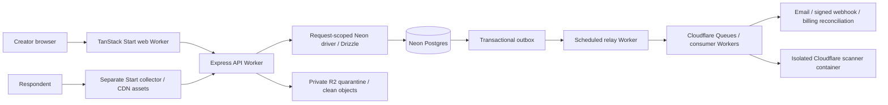

# Technical foundation

**Accepted platform:** 28 October 2026. React/TanStack Start frontends and a TypeScript/Express 5 API run on Cloudflare Workers. Neon PostgreSQL/Drizzle, private R2 and Razorpay remain selected. Superseded framework/deployment proposals are historical records only. Read [ADR-012](decisions/ADR-012-express-workers-native-first.md), [V1 scope](11-v1-scope-and-delivery.md) and the root quality contract. [ADR-013](decisions/ADR-013-shared-database-and-small-commits.md) records the later single-database and low-traffic decisions.

## 1. Architecture

One pnpm workspace, shared contracts and one deterministic form engine. Separate web, collector, API and queue/scheduled Worker deployments isolate workloads without introducing microservices per feature. Start uses Vite and Cloudflare's official plugin. Express runs through Cloudflare's Node HTTP bridge **inside workerd**, not an installed Node server process. Node LTS remains the development/build toolchain. A local representative Express/Workers probe passed; hosted services and full product journeys still need their own evidence.



Business commands go through the API/domain layer; Start server functions do not duplicate authorization or commit logic. Production routing exposes the API under an application-owned same-origin path, via a service binding/Worker route; local development uses Wrangler for API isolate reloads and Vite for frontend refresh, retaining the same service binding. Production builds/previews bundle the auxiliary API Worker. Origin checks use the original Worker Request because the Node HTTP bridge uses an internal HTTP connection. Default deny unknown origins for state-changing requests. This is an additional CSRF/abuse boundary, not authentication. Public session capability and workspace-role checks remain mandatory as implemented. Versioned assets may be cached; sessions/answers/permissions/entitlements are not shared-cache content.

## 2. Stack and dependency policy

| Layer | Selection | Install/use boundary |
|---|---|---|
| Language/toolchain | Strict TypeScript, Node LTS, pnpm workspaces | Pin runtime/package-manager versions and lockfile; workerd compatibility date is separate |
| Frontends | React + TanStack Start/Router; Vite + official Cloudflare plugin | Web, marketing/help and separate collector; never bundle editor code into collector |
| Forms/server state | TanStack Form and Query | Input and remote state; shared engine owns canonical rules; no broad global state for simple components |
| Shared validation | Zod with explicit request/output schemas | Unknown keys/type/size constraints at boundaries; no arbitrary customer code/schema compilation |
| API | Express 5 via `cloudflare:node` HTTP bridge | Small routers and native headers/URL/crypto/streams; centralized sanitized errors and explicit output DTOs |
| Database | Neon managed Postgres 18, Drizzle ORM/Kit, native WebSocket Neon driver | One shared database as requested; request-local pool/transactions; Hyperdrive deferred until measured need |
| Auth | Better Auth + official Drizzle adapter on Neon | Verification/recovery/MFA/revocation and origin/cookie tests precede private features; do not invent auth |
| Object storage | Private Cloudflare R2 | Native bindings; short-lived capabilities, quarantine and authorized retrieval; lightweight signing adapter only if required |
| Jobs | Neon outbox + Cloudflare Queues + Cron | Atomic DB intent then retryable queue publish; dedupe/lease/DLQ/reconciliation; no polling daemon or durable `waitUntil` assumption |
| Native scanning/backups | Isolated Cloudflare container where native tools require it | Not the HTTP API; feasibility/resource/rollout proof is a release gate; no alternate-cloud deployment path |
| Billing | Razorpay Subscriptions + Standard Checkout | Existing account; owner billing/cancel UI; raw-body HMAC, dedupe, reconciliation and test-mode lifecycle |
| Email | Resend + React Email when the flow is built | Distinct auth/notification senders; durable send ledger; native fetch permitted where it keeps integration simpler |
| AI | Bounded TanStack AI/OpenAI adapter when P5/P6 begin | Evidence, semantic validation, usage/storage controls and reservations remain owned; standard fields always work |
| Styling | Semantic CSS tokens and self-hosted DM Sans | Native semantic controls first; add a headless primitive only for behavior native HTML cannot meet cleanly |
| Later UI needs | TanStack Table/Virtual/Store/Pacer/Hotkeys; Radix/shadcn; dnd-kit | Add only for an implemented need; no blanket ecosystem install; manual keyboard reordering remains available |
| Diagnostics | Worker structured logs, Sentry Cloudflare SDK/OTel as justified | Strip request content, auth/capability headers and provider keys; no session replay of respondents |
| Tests | Vitest + official Cloudflare Vitest plugin; focused pure-code coverage; browser journeys | Test actual workerd behavior, not just Node mocks; normal/power/adversarial browser evidence every feature |
| Delivery | Git, GitHub Actions workflow, Wrangler | Short-lived branches, atomic verified commits, read-only CI permissions, protected main when remote exists |

Every new dependency records purpose, native alternative, license, exact version, transitive/runtime cost and measured bundle impact. Development-only tools do not ship to browsers, but their install/CI cost still matters. Native Date/Intl, URL, fetch, AbortController, Web Crypto, streams, semantic forms and CSS are preferred over utility, date, animation or request-wrapper packages. No ORM/API calls in browser bundles. See `CONSTRAINTS.md` and `docs/dependencies.md` for measured gates and current additions.

## 3. Runtime and operating contracts

Use separate local/staging/production identities, keys, Neon branches/roles, R2 buckets, queues and billing modes. No production data in previews. No credentials in Git; example environment files contain names/placeholders only. The API boot path must fail safely when a required integration is unavailable; never replace production persistence with an in-memory fallback.

Database: use a non-owner role with no BYPASSRLS. Set verified workspace context transaction-locally on the same client as all tenant queries; authorize first. The initial connection uses the Neon driver directly; Hyperdrive is deferred, and any future cache must remain off for authoritative data. Always end request-local connections. Migrations run once as explicit release jobs using separate credentials, not at every Worker startup. Neon remains the primary store; D1/Durable Objects do not become competing business databases.

Files: R2 objects stay private, reference an owned session/response and remain pending until checked against limits and scanner outcome. Never mark clean on scanner outage. A maintained ClamAV image may run only as an isolated Cloudflare container, not inside a Worker. If that workload cannot meet requirements, stop file-feature release and record the issue; do not silently change provider. Protected recovery copies use a separate Cloudflare account/bucket/identity with tested retention locks; database history does not include object bytes. Same-provider outage recovery is an explicit limitation, not a promised independent failover.

Auth: use the official Better Auth Express handler, trusted origins, correct multi-cookie behavior and Neon/Drizzle identity storage. Raw-body routes must be mounted before generic JSON parsing. Framework route guards are not API authorization. Owner actions require recent authentication and the stated MFA policy. Staging must prove hashing limits, session revocation, recovery and cookie behavior through the real Worker routing path.

Razorpay: use the existing account. Confirm the enabled Subscription methods/currency/market coverage in test mode, verify callback/webhook signatures against the correct message, dedupe provider event IDs and business transitions, and reconcile uncertain outcomes before creating another subscription. Checkout redirect is not payment proof. Snapform owns billing management; no hosted portal is assumed.

Deploy only to the selected Cloudflare platform. A platform incompatibility or unmet launch target is a blocking engineering decision; there is no alternate-cloud fallback in this plan. Native scanner/container tools are separate from the Express API. Cloudflare capacity, API limits, Neon locality/cold starts, raw bytes, streaming, secrets and rollback need staged evidence before public launch.

Sources checked: [Express/Workers](https://developers.cloudflare.com/workers/tutorials/deploy-an-express-app/), [TanStack Start/Workers](https://developers.cloudflare.com/workers/framework-guides/web-apps/tanstack-start/), [Neon connection options](https://developers.cloudflare.com/workers/databases/third-party-integrations/neon/), [Drizzle/Hyperdrive](https://developers.cloudflare.com/hyperdrive/examples/connect-to-postgres/postgres-drivers-and-libraries/drizzle-orm/), [Queues](https://developers.cloudflare.com/queues/reference/delivery-guarantees/), [Better Auth Express](https://better-auth.com/docs/integrations/express), [Razorpay](https://razorpay.com/docs/payments/subscriptions/integration-guide/). Sources establish integration patterns, not completed Snapform deployment or SLOs.

## 4. Canonical form and engine contract

One versioned definition contains stable field/option/page/rule IDs, type/constraints, safe presentation, applicability/routing, endings, theme reference, locale, public business notice and AI policy. Server-only secrets, private policies and connection credentials never enter the public manifest. V1 has no private scoring; any future confidential rule must remain server-side.

Definitions are input programs in a bounded DSL, not arbitrary executable schemas. Initial limits: 50 answer fields, 10 pages, 30 rules, expression depth 4, 20 choice options per field and 256KB definition JSON. Exceeding a limit is a clear validation error. Revisit these based on real forms, not a parity arms race.

Engine evaluation order:

1. Decode values using the pinned field codec; validate types/limits.
2. Recompute applicability/reachability from confirmed base answers until stable, with bounded passes. Permit conditions only on earlier fields/pages in V1; reject cyclic dependencies at publish.
3. Produce effective answers excluding unreachable values. Stale hidden values stay outside exports, AI context and delivery; purge per retention policy.
4. Evaluate ordered routing rules at page exit. Priority is explicit; equal-priority multiple matching navigation destinations are a publish error. No implicit mutation order.
5. Validate reachable required answers. Compute a deterministic review hash over effective answers, version and revision.
6. Server repeats evaluation at submission; only current reviewed state may commit.

Boolean `false`, number `0`, absent, blank, refused and not-applicable are explicit distinct states. Dates are ISO local dates, not silently converted to UTC instants. Budget records include an explicit ISO currency and unit; V1 does not calculate quotes.

Versioned fixtures must run in browser and server and generate identical normalized output. Definition upgrades are explicit migrations; old engine support remains available for active versions until migrated/revoked.

## 5. Data model and invariants

| Entity | Important keys/invariants |
|---|---|
| workspace, membership, invitation | Composite tenant-scoped identities; one or more active owners; invitation hash/expiry |
| form, form_draft, draft_operation | Tenant/form relationship; monotonically increasing revision; unique operation ID; CAS writes |
| form_version, publication | Immutable definition/config hash; unique form/version; atomic live pointer; explicit revoked state |
| response_session, answer_candidate, answer_state | Pins version; capability hash and expiry; state revision; candidate evidence/confirmation; applicability |
| conversation_turn, ai_run | Unique session/client turn; lease/fencing generation; model/prompt/policy versions; token/cost/outcome |
| response, submission_event, outbox_job | One response per tenant/session; reviewed snapshot, stable event/job identity; atomic outbox insert, lease and next-due time |
| connection, mapping_version, delivery_intent, delivery_attempt | Tenant scope; encrypted secret; frozen mapping/event; separate attempts and uncertain external status |
| upload, scan_job, object_copy_manifest | Tenant/session ownership; quarantine state; file hash; backup object/version linkage |
| knowledge_entry, knowledge_version | Approved immutable text snapshot; sources; active sessions pin it |
| usage_event, usage_reservation, entitlement_projection | Unique billable identity; atomic reservations/limits; rate-card/model cost version |
| subscription_event, audit_event, deletion_tombstone | Provider dedupe; sanitized append-only history; deletion suppression reapplied after restore |

Tenant-aware foreign keys prevent a response referencing another workspace's form version. JSONB holds variable definitions/answers; relational columns index workspace, form, version, status and timestamps. No table per customer form. Index `(workspace_id, form_id, created_at, id)` for cursor queries; add projections only after query evidence.

RLS is defense in depth, not the sole API authorization. Use dedicated non-owner roles without BYPASSRLS; after session/membership verification set tenant context transaction-locally on the same connection as tenant queries. Never retain tenant context across pooled requests. Auth/session tables have separately scoped grants, since login cannot depend on an already selected workspace. Migration/admin credentials never enter browser bundles or ordinary request paths. Workers validate outbox/event/tenant relationships; queue payloads carry IDs, not answer content. Any future Hyperdrive cache stays off for these operations. Test cross-tenant access and transaction cleanup through the Worker transport. [PostgreSQL RLS](https://www.postgresql.org/docs/current/ddl-rowsecurity.html).

## 6. API and reliability contracts

| Endpoint family | Preconditions and result |
|---|---|
| `PATCH /v1/forms/:id/draft` | Membership/editor, expected revision, unique operation ID; 409 on conflict |
| `POST /v1/forms/:id/validate` | Compiles exact revision; returns issues keyed by field/rule and validation hash |
| `POST /v1/forms/:id/publish` | Expected revision/hash; transaction creates version and live pointer |
| `GET /v1/public/:slug/manifest` | Public allowlisted projection; immutable version ETag; no tenant secrets |
| `POST /v1/public/:slug/sessions` | Rate/abuse/entitlement reservation checks; returns scoped capability and pinned version |
| `PUT /v1/sessions/:id/answers/:fieldId` | Capability, request ID and state revision; validate and return authoritative state delta |
| `POST /v1/sessions/:id/turns` | Client turn ID/revision; claim lease, validate candidate output and CAS commit |
| `POST /v1/sessions/:id/submit` | Capability, idempotency key, reviewed state hash/revision, required acknowledgments |
| `GET /v1/responses` / `POST /v1/exports` | Workspace role, cursor/limits; sensitive data private/no shared cache |
| `POST /v1/deliveries/:id/retry` | Editor/owner, safe replay classification, audit; no response mutation |
| `POST /v1/billing/events` | Verify raw-body signature, persist provider event, asynchronous entitlement reconciliation |

Errors have stable code, safe message, issue IDs and request ID; never include raw tokens or SQL. Use 401/403/404 without resource enumeration, 409 revision/idempotency conflict, 422 validation and 429 with bounded retry guidance. Public session capabilities cannot access control API routes. CORS allowlists are not authorization. Define cookie CSRF/Origin checks and embed-compatible bearer capability storage during the security design spike.

**Submit transaction:** lock session → check revocation/reservation/review revision → engine validation → insert response (unique session) → insert stable business event, delivery intents and outbox jobs → insert deduplicated usage event → consume reservation → mark submitted → commit → return durable response ID. All these database writes commit together. No external API or queue publication is inside this transaction.

**Outbox relay:** scheduled Worker claims a bounded batch of due outbox rows using a lease/fencing token and commits the claim. It publishes IDs to Cloudflare Queues outside the database transaction, then marks dispatched after queue acknowledgment. Crash after publish but before marking can duplicate a queue message; consumers dedupe stable job/event identities. Crash before publish leaves a lease that expires for recovery. A one-minute scheduled sweep is the safety net; an optional post-commit dispatch hint can reduce latency but is not the durability mechanism. Queue outage does not erase committed responses or jobs.

**Consumer/reconciliation:** check tenant, current deletion state and job lease; perform bounded work; persist result before acknowledging the queue. Cloudflare Queues is at least once. Messages may duplicate or arrive out of order; do not treat FIFO or queue acknowledgment as a remote business receipt. Exhausted transport retries route to DLQ and alert. Business `next_attempt_at` remains in Neon, so long retry schedules and recovery after queue retention expiry can be rebuilt without recreating submissions or billing usage. Do not run a pg-boss polling daemon in a Worker or rely on `waitUntil()` for durable delivery. [Queue delivery guarantees](https://developers.cloudflare.com/queues/reference/delivery-guarantees/), [queue limits](https://developers.cloudflare.com/queues/platform/limits/).

**Delivery:** claim attempt with lease/fencing; deliver outside DB transaction; persist acknowledgment. Stable event/mapping identity survives retries. Proposed schedule: immediate, 1m, 5m, 30m, 2h, 8h, 24h with jitter. Enforce HTTP timeout/bytes, SSRF checks and no redirects; bounded Retry-After; permanent config errors pause. Unknown external outcomes require reconciliation, not blind replay. Receiver dedupes event ID; universally exactly-once external effects are not promised.

**Razorpay:** verify `X-Razorpay-Signature` against the original raw body using HMAC-SHA256 and the environment's webhook secret. Dedupe `x-razorpay-event-id` and business resource transitions; do not assume ordered events or trust a browser Checkout success callback as final entitlement proof. Keep subscription creation/retry operation IDs and reconcile uncertain provider outcomes before creating another subscription. Snapform exposes its own owner billing management UI for status, receipts/invoices as available, renewal/cancellation and grace. No Stripe portal is assumed. Resend's provider idempotency window remains separate from our durable send ledger. [Razorpay verification](https://razorpay.com/docs/webhooks/validate-test/), [Resend keys](https://resend.com/docs/dashboard/emails/idempotency-keys).

## 7. AI policy and model selection

Start with one provider and a thin TanStack AI adapter; keep budget, evidence and commit policy in our domain layer. Benchmark **GPT-6 Luna** for bounded extraction/FAQ and **GPT-6.1 Sol** for draft generation/edits; these are candidate defaults, not an assertion of task fitness. Select the cheapest candidate that meets the same quality and latency gates; no automatic escalation from a cheap model to an expensive model without budget reservation. Record an immutable available snapshot ID where offered; otherwise record alias/date/config and rerun canary evals to detect upstream changes. [Model catalog](https://developers.openai.com/api/docs/models).

Use strict structured outputs and server semantic validation. Check refusal, truncation, empty output and unsupported schema paths. Provider schema restrictions are not the product DSL; generate a compatible model-facing schema adapter and test it. Structured output does not prove factual correctness. [Structured outputs](https://developers.openai.com/api/docs/guides/structured-outputs).

Turn sequence: reserve worst-case spend → claim short per-session lease/fencing token → read pinned state → call provider with bounded context outside transaction → validate candidates/knowledge support → CAS commit turn and accepted candidate state → reconcile actual cost/release remainder. A crash expires the lease; a stale run cannot overwrite a newer one. Duplicate client turn retrieves prior state, not a new billable call where recovery can determine prior completion.

Initial hard limits from FR-31 plus **$0.15 maximum provider spend/session** and an owner/workspace monthly cap. The monetary limit may terminate before token limits for a selected model. Reserve before dispatch to prevent concurrent overspend, including hidden/reasoning billable tokens where relevant. Enforce one active turn/session, two active AI sessions/workspace initially and bounded global concurrency; make fair queuing explicit.

Use `store:false` for Responses, own bounded conversation state, and no provider file/vector/agent persistence in V1. This does not by itself imply zero retention: abuse-monitoring and feature/model-specific data rules remain separate. Document actual provider processing and contractual settings. Never promise zero retention or residency based only on a request parameter. [OpenAI data controls](https://developers.openai.com/api/docs/guides/your-data).

## 8. Non-functional release targets

Every value is a **target to test**, not a measured result or customer SLA. Baseline design load: 100 paid workspaces; 100,000 submitted records/month; 200 concurrent standard sessions; 20 durable submits/second sustained for 30 minutes, burst 50/second for 60 seconds; 10 simultaneous AI calls under provider quota. Form fixture: 20 fields, 5 rules, no media in initial render. Test 50-field maximum separately. Responses retained for load tests: 1 million synthetic records across tenants; file/AI workloads tested independently and together.

| ID / dimension | Target and measurement | Release evidence |
|---|---|---|
| NFR-01 Collection availability | ≥99.9% over rolling 30 days; collection journey synthetic every minute plus server good-request ratio; include deploy failures | 14-day beta soak and monitoring; ongoing error budget ~43.2m/30 days, internal target only |
| NFR-02 Standard performance | p95 usable form ≤2s on agreed mid-range Android/4G profile; field interaction INP p75 ≤200ms; CLS p75 ≤0.1 | Real-device/lab profile documented; RUM without answer content |
| NFR-03 Submit performance | p95 durable acknowledgment ≤800ms at baseline load, uploads/AI/delivery outside critical path | k6 report including p99 and errors; server processing plus separately labeled end-to-end latency |
| NFR-04 AI latency | p95 first useful validated response ≤3s; visible fallback by 8s; UI always allows immediate switch | Provider/cold/warm profiles, timeout tests, no fake progress percentages |
| NFR-05 Durability | No acknowledged response lost in tested crash scenarios; repeated submit returns one response | Failure injection around commit/enqueue/ack; restore validation |
| NFR-06 Recovery | Database RPO ≤5m with PITR; uploads RPO ≤1h with copies; RTO ≤4h for restore+service recovery | Timed representative isolated restore; include missing recent objects in customer recovery policy |
| NFR-07 Accessibility | WCAG 2.2 AA target for creator and respondent; all core journeys keyboard/screen-reader usable | Automated checks plus VoiceOver/Safari and NVDA/Chrome manual review |
| NFR-08 Security | No unresolved critical/high launch findings in scoped review; zero cross-tenant accesses in defined corpus | Independent application/security review, tenant tests, secret scan; not a claim of zero vulnerabilities |
| NFR-09 Delivery | ≥99% eligible healthy-destination events acknowledged ≤5m; provider outages reported separately | Attempt/latency metrics, deliberate timeout/429/token-expiry/replay tests |
| NFR-10 Privacy | No raw content/secrets in operational analytics; active purge ≤7d; declared retention jobs monitored | Log sampling, deletion drills, restore tombstone verification |
| NFR-11 Maintainability | Strict TS, deterministic engine, backward fixtures, reviewed migrations, reproducible deploy | CI lint/type/build/tests, contract diff check, rollback rehearsal |
| NFR-12 Cost isolation | Hard per-session/workspace budgets and bounded file/queue resource use; no duplicate usage billing | Concurrent reservation tests and reconciled provider ledger |

WCAG is a conformance target requiring component and journey evidence; using a component library is insufficient. [W3C WCAG 2.2](https://www.w3.org/TR/WCAG22/).

**SLO response:** collect errors, queue age, AI budget exhaustion, auth failures, object scan backlog and export saturation. Alert if synthetic submit fails twice consecutively, 5xx >2% for 5m with sufficient volume, oldest eligible delivery >5m, or budget reservation reconciliation stalls. Low-volume synthetic failures still page. During rapid error-budget burn freeze risky deploys and disable AI/nonessential workers before compromising collection.

## 9. Security, privacy and recovery design

- CSP, escaped text, allowlisted URLs and image types; no arbitrary HTML/CSS/JS, no content-based eval. Webhook SSRF defense blocks private/link-local/metadata IPs on every resolution/connection, pins permitted addresses through a hardened egress path, rejects redirects and enforces timeout/bytes limits.
- Encrypt provider credentials with a key outside the database; rotate with overlap and audit. Client bundles contain only public keys/manifest. Scrub cookies, Authorization, capabilities, email and answer content from traces.
- Auth verifies identity; each API/worker/file/export authorizes workspace and role. Rate limits partition tenant/form/IP; trust proxy/IP only from known edge. API origin also enforces controls if edge is bypassed.
- File quarantine and scanner isolated from API privileges. Outage means pending, never bypass. Threat tests include disguised files, parser exhaustion, stale signed URLs and deletion races.
- Keep content out of metric dimensions; no session replay on respondent pages. Essential transactional counters use first-party server events. Public form owner is responsible for collection purpose/notice; platform supplies tools and contract review, not automatic compliance.
- Backups: Neon plan with configured PITR history plus protected exports; private file copies hourly with content hashes/version manifest; quarterly timed restore and prelaunch drill; restore into isolated environment; reapply deletions before opening traffic. RPO/RTO promises require actual measured procurement and drill results.
- The user explicitly selected one shared development/production database; it is a shared trust boundary. Automated synthetic writes must roll back, and previews must not read customer content as test fixtures. Keep migration/runtime privileges separate and provider billing in test mode during development. Production migrations use expand/contract; app rollback must tolerate previous and new schema. Backups do not replace a reversible migration plan.

## 10. Verification and release evidence

Use tests where failure has real consequence. Engine fixture corpus ≥100 paths plus property tests; tenant negative matrix for routes/jobs/files/exports; integration tests use real Postgres/RLS/outbox transactions plus actual workerd/queue integration, not just mocked repositories; browser tests cover authoring→publication→mobile→response→delivery and interruption/retry. [Playwright](https://playwright.dev/docs/intro).

AI gates: ≥100 representative authoring briefs, ≥300 labeled extraction/correction cases, ≥100 supported/unsupported/adversarial knowledge questions. Hold out at least 30% from prompt tuning. Report counts, types and uncertainty by cohort. Targets: 100% final proposal schema/reference validity after allowed repair; ≥95% supported-brief task success by human rubric; ≥98% exact normalized match for unambiguous extraction cases; zero unsupported consequential business claims or unconfirmed critical values committed in release corpus. Require abstention tests, including successful abstention on unsupported questions; measure supported-question answer coverage (initial target ≥80%) so refusal alone cannot “pass.” Zero observed critical errors is not a population guarantee.

Manual release checks include keyboard/IME, screen readers, 320/768/1024/1440px, slow networks, expired session, refresh, double submit, stale AI, role removal, provider outages, billing delays, 429s and restore. Keep evidence with build hash/model config and owner sign-off. Include a deployed Express Worker/Neon/queue/R2 slice before committing to that runtime; the local Express probe does not prove provider integration. No reduced security/reliability bar to recover schedule.

## 11. Proposed repository and commands

```text
apps/web/                TanStack Start authoring, marketing and help
apps/collector/          Separate TanStack Start collector and static assets
apps/api/                Express Worker / Better Auth HTTP boundary
apps/worker/             Cloudflare queue/scheduled handlers and outbox relay
apps/scanner/            Later isolated Cloudflare ClamAV workload
packages/platform/       Neon transports, queue/storage/runtime adapters
packages/contracts/      Static request/event/definition contracts
packages/form-engine/    Pure codecs, applicability, navigation, compiler
packages/form-ui/        Shared respondent field registry
packages/ui/             Authoring components and tokens
packages/database/       Drizzle schema, SQL migrations, tenant repositories
packages/ai/             Provider adapter, policy, versioned eval harness
packages/integrations/   Email and webhook adapters
packages/metering/       Ledger, reservations and policy projection
tests/integration/       Postgres/queue/isolation/failure tests
tests/e2e/               Browser journeys
tests/load/              k6 profiles
docs/                    Product/technical/operating records
```

Implemented scripts: `pnpm dev`, `pnpm types:generate`, `pnpm check:fast`, `pnpm test:unit`, `pnpm test:api`, `pnpm test:preview`, `pnpm test:dev-reload`, `pnpm build`, `pnpm check:bundle` and `pnpm check`. Install with `pnpm install --frozen-lockfile`. The production HTTP smoke test verifies SSR/CSP nonces and the actual web → Express service binding. Database scripts now include `pnpm db:generate`, `pnpm db:migrate`, `pnpm db:bootstrap`, `pnpm test:db` and `pnpm test:auth:integration`. AI, load and automated whole-product browser scripts remain future capabilities. Migration runs are explicit release jobs, never API startup. See [slice 1 evidence](development/0001-workers-intake-validation.md).

## 12. Scale without speculative architecture

Profile before changing infrastructure. Reduce database round trips, bound all queries/payloads/queues, stream exports and uploads, and keep CPU-heavy work off submit. Add TanStack DB only for a measured client collection need, pgvector only for a proven larger approved knowledge corpus, and orchestration only for actual long-lived workflows. No microservices, extra cloud provider, generic event bus or dependency is added for hypothetical scale.

Every feature follows test-first logic verification, real Worker integration checks, browser workflows in three user modes and an explicit performance/dependency review. Budget/regression failures block completion; never hide them by suppressing errors, deleting assertions or weakening thresholds. Deployment artifacts, model policies and schema versions are recorded with verification evidence.

The pinned local toolchain is Node 24.14.0, pnpm 10.34.5 and TypeScript 6.0.3. Workers use compatibility date 2026-10-23, supported by both pinned local toolchains; this is intentionally distinct from the document date. Dependency versions/licenses and emitted sizes are in [the inventory](dependencies.md).
