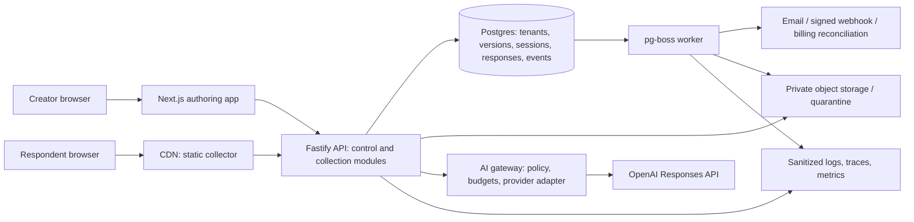

# Technical foundation

**Status:** Proposed architecture and release targets, not implemented guarantees. Solo founder plus specialist reviews. Sources checked 27 October 2026; pin exact compatible package/provider versions at implementation kickoff.

## 1. Architectural decision

Use a TypeScript modular monolith in a pnpm workspace, with independently deployable authoring web, static public collector, API, and background worker. Shared pure packages own contracts and rule semantics. One managed Postgres stores business data, durable events and jobs. Separate process capacity prevents a slow export, AI call or integration from blocking collection.



There is one codebase, not a microservice per diagram box. Control and collection are initially modules in the same API deployment, with separate routes, auth, rate limits and connection budgets; split their deployments only if noisy-neighbor/load evidence requires it. Public static assets remain available during authoring outages, although API/database failure can still prevent durable submit.

## 2. Selected stack and library inventory

“Selected” means the recommended implementation baseline; paid procurement and compatibility checks remain tasks. Do not resolve `latest` in production CI. Commit lockfile, runtime version, image digest and evaluated model configuration.

| Concern | Selection | Purpose / scope / alternative |
|---|---|---|
| Language/runtime | TypeScript strict mode; supported Node.js LTS (baseline Node 24, verify support at kickoff) | One language across apps/workers; no Python runtime requirement |
| Creator/marketing | Next.js App Router + React | App shell, public marketing/docs, authenticated editor; no business logic hidden in route-specific UI |
| Respondent | React + Vite, separate static build | Small bundle and shared field components; guided chat code loads only on opt-in |
| API | Fastify + `@fastify/cookie`, `@fastify/cors`, `@fastify/helmet`, `@fastify/swagger` | Explicit REST/OpenAPI; audited request schemas; cookie/CSRF/origin policy |
| Contracts | Zod 4 + native JSON Schema export | Source for static contracts; generated portable schemas with round-trip/fixture checks |
| Persistence | PostgreSQL + `pg`, Drizzle ORM and Drizzle Kit | SQL-friendly transactions, migrations, composite tenant keys; use reviewed SQL for RLS and constraints |
| Identity | Supabase Auth + `@supabase/supabase-js`, SSR adapter where needed | Verified accounts/reset/OAuth/MFA; Snapform owns memberships and authorization |
| Durable jobs | `pg-boss` | Postgres-backed retry/concurrency; create jobs in the business transaction using Drizzle adapter |
| Typography and motion | Self-hosted DM Sans Variable (OFL 1.1), native CSS transitions/keyframes | Foundation 0.2; one font family, no remote font requests or added animation runtime; preserve reduced-motion behavior |
| UI primitives | Radix primitives, locally owned shadcn/ui components, Tailwind CSS | Accessible foundations with first-party tokens; include only used components |
| Inputs/state | React Hook Form, TanStack Query, small Zustand editor store | Inputs, remote state, normalized local draft selection/operations; engine owns validation/routing |
| Reordering | `@dnd-kit/core` + sortable adapter | Keyboard-capable field order; always provide Move up/down buttons |
| Tables/virtualization | TanStack Table; Virtual only after measured need | Cursor-backed results; no 10k-row browser payloads |
| Icons | Lucide React | Consistent 16/20px icons with accessible names |
| Text/CSV/file checks | React escaped text; `csv-stringify`, `file-type` | No WYSIWYG HTML in V1; explicit spreadsheet formula escaping; file signatures are one check, not malware protection |
| AI | Official `openai` JavaScript SDK, Responses API, strict structured outputs | Thin server adapter; no agent framework, remote browsing, or unrestricted tool executor |
| Notifications | `resend`, React Email | Auth and internal notification templates, provider idempotency, bounce/suppression handling |
| Billing | `stripe` SDK, hosted Checkout and Portal, subject to merchant eligibility | Snapform SaaS subscription only; alternative approved provider through same billing interface |
| Observability | Pino, OpenTelemetry SDK, Sentry SDK | Structured sanitized logs, trace propagation, exceptions and alerts; strip content and tokens |
| Tests | Vitest, Testing Library, fast-check, Playwright, `@axe-core/playwright`, k6 | Engine properties, integration failures, real browser flows, accessibility and load |
| Design QA | Storybook | States and visual/accessibility review for field registry/editor components |
| Tooling | pnpm, ESLint, Prettier, GitHub Actions, Docker | Dependency lock, CI checks, reproducible artifacts and environment separation |

Next.js documents a Node minimum and explicit lint setup; run lint independently of the production build. Zod can export JSON Schema, but engine semantics remain application logic. Fastify warns that its schema compiler treats schema as code: **never pass arbitrary imported/customer JSON Schema directly to Fastify/Ajv compilation**. Validate a bounded form-definition DSL with trusted static schemas, then interpret field constraints in the pure engine. [Next.js](https://nextjs.org/docs/app/getting-started/installation), [Zod](https://zod.dev/json-schema), [Fastify](https://fastify.dev/docs/latest/Reference/Validation-and-Serialization/).

Radix handles important interaction primitives, but product composition still requires accessibility testing. shadcn/ui provides owned component source; updates and correctness remain our responsibility. [Radix](https://www.radix-ui.com/primitives/docs/overview/accessibility), [shadcn/ui](https://ui.shadcn.com/docs).

Design revision, 28 October 2026: the application stack is retained. The local HTML/CSS specimen demonstrates the new direction; it does not replace React, Tailwind or Radix in the planned product. Font source is `@fontsource-variable/dm-sans@5.3.0`; see `design/fonts/README.md`. Pin other runtime packages at implementation kickoff after compatibility checks.

**Licensing gate:** capture package/version/license in an SBOM and review SaaS redistribution, font/icon licenses and transitive dependencies. This inventory is not a completed license audit. Evaluate SurveyJS only in a time-boxed spike if its component-specific commercial license and UX fit beat owning a bounded field registry. Do not mix two canonical engines.

## 3. Services and procurement checklist

| Service | Default choice | Necessary configuration / failure behavior |
|---|---|---|
| Hosting | Render paid web service for Next, paid API, paid worker, static collector CDN | Autosleep-free production, health checks, deploy rollback, capacity isolation and connection pooling; host failure can affect submit |
| Database/Auth/Storage | Separate Supabase production and staging projects on paid plans | Non-owner application role, RLS, private buckets, auth SMTP, TLS/network restrictions, secrets, spend alerts |
| Edge/DNS/abuse | Cloudflare DNS/proxy where compatible + Turnstile | Cache public versioned assets only; challenge based on risk; validate challenge server-side; strict cache bypass for sessions/answers |
| Email | Resend | Verified SPF/DKIM/DMARC, auth sender separate from customer notifications, disabled tracking on auth links, bounded retries |
| AI | OpenAI API project per environment | Server keys, rate/cost limits, explicit data controls, model allowlist, no silent provider substitution |
| Billing | Stripe if the selling entity can onboard | Eligibility/KYC, test webhook failures, invoice/tax/refund rules; resolve alternative before investing in checkout |
| File scanning | Isolated ClamAV scanner container on worker infrastructure | Maintained signatures, CPU/memory/file limits, no internet execution of file content; scan failure means pending/quarantine, not clean |
| Recovery copy | Separate-account S3 backup bucket | Encrypted/versioned file copies plus protected database exports and deletion manifest; scoped backup identity cannot delete retention copies |
| Monitoring/support | Sentry + external uptime checks (e.g. Better Stack); support mailbox/help pages | Alerts reach a named responder and backup; status page hosted outside collection stack |
| Code/deploy | GitHub private repository + Actions | Protected production branch, least-privilege deploy credentials, approvals for production migration, dependency alerting |

Start in **one agreed region** close to pilot traffic; Singapore is the provisional choice if initial users are primarily India/APAC, otherwise select before data collection. Match API/worker/database geography; backups and AI/email data paths require separate review. Render documents its regions and CDN behavior; a hosting region is not a contractual end-to-end residency guarantee. [Render regions](https://render.com/docs/regions), [workers](https://render.com/docs/background-workers).

Supabase production setup requires explicit RLS, auth/email and backup configuration. Its database backup does **not** include Storage object bytes; implement and test file backup separately. [Production checklist](https://supabase.com/docs/guides/deployment/going-into-prod), [backup coverage](https://supabase.com/docs/guides/platform/backups).

If the entity is Indian, Stripe currently describes new access as invite-only. Confirm actual account eligibility early; do not infer it from founder location or promise an alternative provider's acceptance. [Stripe India](https://docs.stripe.com/india-accept-international-payments).

## 4. Canonical form and engine contract

One versioned definition contains stable field/option/page/rule IDs, type/constraints, safe presentation, applicability/routing, endings, theme reference, locale, public business notice and AI policy. Server-only secrets, private policies and connection credentials never enter the public manifest. V1 has no private scoring; any future confidential rule must remain server-side.

Definitions are input programs in a bounded DSL, not arbitrary executable schemas. Initial limits: 50 answer fields, 10 pages, 30 rules, expression depth 4, 20 choice options per field and 256KB definition JSON. Exceeding a limit is a clear validation error. Revisit these based on real forms, not a parity arms race.

Engine evaluation order:

1. Decode values using the pinned field codec; validate types/limits.
2. Recompute applicability/reachability from confirmed base answers until stable, with bounded passes. Permit conditions only on earlier fields/pages in V1; reject cyclic dependencies at publish.
3. Produce effective answers excluding unreachable values. Stale hidden values stay outside exports, AI context and delivery; purge per retention policy.
4. Evaluate ordered routing rules at page exit. Priority is explicit; equal-priority multiple matching navigation destinations are a publish error. No implicit mutation order.
5. Validate reachable required answers. Compute a deterministic review hash over effective answers, version and revision.
6. Server repeats evaluation at submission; only current reviewed state may commit.

Boolean `false`, number `0`, absent, blank, refused and not-applicable are explicit distinct states. Dates are ISO local dates, not silently converted to UTC instants. Budget records include an explicit ISO currency and unit; V1 does not calculate quotes.

Versioned fixtures must run in browser and server and generate identical normalized output. Definition upgrades are explicit migrations; old engine support remains available for active versions until migrated/revoked.

## 5. Data model and invariants

| Entity | Important keys/invariants |
|---|---|
| workspace, membership, invitation | Composite tenant-scoped identities; one or more active owners; invitation hash/expiry |
| form, form_draft, draft_operation | Tenant/form relationship; monotonically increasing revision; unique operation ID; CAS writes |
| form_version, publication | Immutable definition/config hash; unique form/version; atomic live pointer; explicit revoked state |
| response_session, answer_candidate, answer_state | Pins version; capability hash and expiry; state revision; candidate evidence/confirmation; applicability |
| conversation_turn, ai_run | Unique session/client turn; lease/fencing generation; model/prompt/policy versions; token/cost/outcome |
| response, submission_event | One response per tenant/session; snapshot of reviewed effective data, stable event ID |
| connection, mapping_version, delivery_intent, delivery_attempt | Tenant scope; encrypted secret; frozen mapping/event; separate attempts and uncertain external status |
| upload, scan_job, object_copy_manifest | Tenant/session ownership; quarantine state; file hash; backup object/version linkage |
| knowledge_entry, knowledge_version | Approved immutable text snapshot; sources; active sessions pin it |
| usage_event, usage_reservation, entitlement_projection | Unique billable identity; atomic reservations/limits; rate-card/model cost version |
| subscription_event, audit_event, deletion_tombstone | Provider dedupe; sanitized append-only history; deletion suppression reapplied after restore |

Tenant-aware foreign keys prevent a response referencing another workspace's form version. JSONB holds variable definitions/answers; relational columns index workspace, form, version, status and timestamps. No table per customer form. Index `(workspace_id, form_id, created_at, id)` for cursor queries; add projections only after query evidence.

RLS is defense in depth, not the sole API authorization. Use a dedicated non-owner role without BYPASSRLS and transaction-local tenant context after membership verification. Never keep tenant context on a pooled connection between requests. Workers validate tenant/event relationships; job payloads carry IDs, not full sensitive content. Queue roles have narrow grants and the pg-boss schema is not exposed by the public Data API. Migration roles are separate. Supabase service-role keys bypass RLS and must not become a general browser or API shortcut. [RLS guidance](https://supabase.com/docs/guides/database/postgres/row-level-security).

## 6. API and reliability contracts

| Endpoint family | Preconditions and result |
|---|---|
| `PATCH /v1/forms/:id/draft` | Membership/editor, expected revision, unique operation ID; 409 on conflict |
| `POST /v1/forms/:id/validate` | Compiles exact revision; returns issues keyed by field/rule and validation hash |
| `POST /v1/forms/:id/publish` | Expected revision/hash; transaction creates version and live pointer |
| `GET /v1/public/:slug/manifest` | Public allowlisted projection; immutable version ETag; no tenant secrets |
| `POST /v1/public/:slug/sessions` | Rate/abuse/entitlement reservation checks; returns scoped capability and pinned version |
| `PUT /v1/sessions/:id/answers/:fieldId` | Capability, request ID and state revision; validate and return authoritative state delta |
| `POST /v1/sessions/:id/turns` | Client turn ID/revision; claim lease, validate candidate output and CAS commit |
| `POST /v1/sessions/:id/submit` | Capability, idempotency key, reviewed state hash/revision, required acknowledgments |
| `GET /v1/responses` / `POST /v1/exports` | Workspace role, cursor/limits; sensitive data private/no shared cache |
| `POST /v1/deliveries/:id/retry` | Editor/owner, safe replay classification, audit; no response mutation |
| `POST /v1/billing/events` | Verify raw-body signature, persist provider event, asynchronous entitlement reconciliation |

Errors have stable code, safe message, issue IDs and request ID; never include raw tokens or SQL. Use 401/403/404 without resource enumeration, 409 revision/idempotency conflict, 422 validation and 429 with bounded retry guidance. Public session capabilities cannot access control API routes. CORS allowlists are not authorization. Define cookie CSRF/Origin checks and embed-compatible bearer capability storage during the security design spike.

**Submit transaction:** lock session → check revocation/reservation/review revision → engine validation → insert response (unique session) → insert stable business event and delivery intents → enqueue pg-boss jobs using the same database transaction → insert deduplicated usage event → consume reservation → mark submitted → commit → return durable response ID. No external call inside transaction.

pg-boss documents existing-transaction enqueue and Drizzle adapters. Use this as the durable enqueue mechanism instead of Redis plus a separate outbox dispatcher. Business events/intents remain independently retained for reconciliation and audit; they can recreate missing jobs idempotently. Verify rollback behavior in integration tests. [Transaction adapters](https://pgboss.io/api/adapters).

**Delivery:** at least once scheduling with application dedupe; claim attempt under lease/fencing token, read non-deleted response, deliver outside DB transaction, persist acknowledgment. Stable event/mapping identity survives retry. Proposed webhook retries: immediate, 1m, 5m, 30m, 2h, 8h, 24h with jitter; receiver dedupes event ID. Do not follow redirects. HTTP timeout 10s; honor bounded Retry-After. Permanent 4xx/config errors pause for repair. Ordering is not guaranteed; payload carries response version/event timestamp.

Resend's idempotency window is 24 hours, so retain our own durable send ledger and avoid blind replay of unknown email outcomes beyond that window. Stripe signatures, duplicates and event ordering also require application handling. [Resend keys](https://resend.com/docs/dashboard/emails/idempotency-keys), [Stripe events](https://docs.stripe.com/webhooks).

## 7. AI policy and model selection

Start with one provider and a thin adapter. Benchmark **GPT-6 Luna** for bounded extraction/FAQ and **GPT-6.1 Sol** for draft generation/edits; these are candidate defaults, not an assertion of task fitness. Select the cheapest candidate that meets the same quality and latency gates; no automatic escalation from a cheap model to an expensive model without budget reservation. Record an immutable available snapshot ID where offered; otherwise record alias/date/config and rerun canary evals to detect upstream changes. [Model catalog](https://developers.openai.com/api/docs/models).

Use strict structured outputs and server semantic validation. Check refusal, truncation, empty output and unsupported schema paths. Provider schema restrictions are not the product DSL; generate a compatible model-facing schema adapter and test it. Structured output does not prove factual correctness. [Structured outputs](https://developers.openai.com/api/docs/guides/structured-outputs).

Turn sequence: reserve worst-case spend → claim short per-session lease/fencing token → read pinned state → call provider with bounded context outside transaction → validate candidates/knowledge support → CAS commit turn and accepted candidate state → reconcile actual cost/release remainder. A crash expires the lease; a stale run cannot overwrite a newer one. Duplicate client turn retrieves prior state, not a new billable call where recovery can determine prior completion.

Initial hard limits from FR-31 plus **$0.15 maximum provider spend/session** and an owner/workspace monthly cap. The monetary limit may terminate before token limits for a selected model. Reserve before dispatch to prevent concurrent overspend, including hidden/reasoning billable tokens where relevant. Enforce one active turn/session, two active AI sessions/workspace initially and bounded global concurrency; make fair queuing explicit.

Use `store:false` for Responses, own bounded conversation state, and no provider file/vector/agent persistence in V1. This does not by itself imply zero retention: abuse-monitoring and feature/model-specific data rules remain separate. Document actual provider processing and contractual settings. Never promise zero retention or residency based only on a request parameter. [OpenAI data controls](https://developers.openai.com/api/docs/guides/your-data).

## 8. Non-functional release targets

Every value is a **target to test**, not a measured result or customer SLA. Baseline design load: 100 paid workspaces; 100,000 submitted records/month; 200 concurrent standard sessions; 20 durable submits/second sustained for 30 minutes, burst 50/second for 60 seconds; 10 simultaneous AI calls under provider quota. Form fixture: 20 fields, 5 rules, no media in initial render. Test 50-field maximum separately. Responses retained for load tests: 1 million synthetic records across tenants; file/AI workloads tested independently and together.

| ID / dimension | Target and measurement | Release evidence |
|---|---|---|
| NFR-01 Collection availability | ≥99.9% over rolling 30 days; collection journey synthetic every minute plus server good-request ratio; include deploy failures | 14-day beta soak and monitoring; ongoing error budget ~43.2m/30 days, internal target only |
| NFR-02 Standard performance | p95 usable form ≤2s on agreed mid-range Android/4G profile; field interaction INP p75 ≤200ms; CLS p75 ≤0.1 | Real-device/lab profile documented; RUM without answer content |
| NFR-03 Submit performance | p95 durable acknowledgment ≤800ms at baseline load, uploads/AI/delivery outside critical path | k6 report including p99 and errors; server processing plus separately labeled end-to-end latency |
| NFR-04 AI latency | p95 first useful validated response ≤3s; visible fallback by 8s; UI always allows immediate switch | Provider/cold/warm profiles, timeout tests, no fake progress percentages |
| NFR-05 Durability | No acknowledged response lost in tested crash scenarios; repeated submit returns one response | Failure injection around commit/enqueue/ack; restore validation |
| NFR-06 Recovery | Database RPO ≤5m with PITR; uploads RPO ≤1h with copies; RTO ≤4h for restore+service recovery | Timed representative isolated restore; include missing recent objects in customer recovery policy |
| NFR-07 Accessibility | WCAG 2.2 AA target for creator and respondent; all core journeys keyboard/screen-reader usable | Automated checks plus VoiceOver/Safari and NVDA/Chrome manual review |
| NFR-08 Security | No unresolved critical/high launch findings in scoped review; zero cross-tenant accesses in defined corpus | Independent application/security review, tenant tests, secret scan; not a claim of zero vulnerabilities |
| NFR-09 Delivery | ≥99% eligible healthy-destination events acknowledged ≤5m; provider outages reported separately | Attempt/latency metrics, deliberate timeout/429/token-expiry/replay tests |
| NFR-10 Privacy | No raw content/secrets in operational analytics; active purge ≤7d; declared retention jobs monitored | Log sampling, deletion drills, restore tombstone verification |
| NFR-11 Maintainability | Strict TS, deterministic engine, backward fixtures, reviewed migrations, reproducible deploy | CI lint/type/build/tests, contract diff check, rollback rehearsal |
| NFR-12 Cost isolation | Hard per-session/workspace budgets and bounded file/queue resource use; no duplicate usage billing | Concurrent reservation tests and reconciled provider ledger |

WCAG is a conformance target requiring component and journey evidence; using a component library is insufficient. [W3C WCAG 2.2](https://www.w3.org/TR/WCAG22/).

**SLO response:** collect errors, queue age, AI budget exhaustion, auth failures, object scan backlog and export saturation. Alert if synthetic submit fails twice consecutively, 5xx >2% for 5m with sufficient volume, oldest eligible delivery >5m, or budget reservation reconciliation stalls. Low-volume synthetic failures still page. During rapid error-budget burn freeze risky deploys and disable AI/nonessential workers before compromising collection.

## 9. Security, privacy and recovery design

- CSP, escaped text, allowlisted URLs and image types; no arbitrary HTML/CSS/JS, no content-based eval. Webhook SSRF defense blocks private/link-local/metadata IPs on every resolution/connection, pins permitted addresses through a hardened egress path, rejects redirects and enforces timeout/bytes limits.
- Encrypt provider credentials with a key outside the database; rotate with overlap and audit. Client bundles contain only public keys/manifest. Scrub cookies, Authorization, capabilities, email and answer content from traces.
- Auth verifies identity; each API/worker/file/export authorizes workspace and role. Rate limits partition tenant/form/IP; trust proxy/IP only from known edge. API origin also enforces controls if edge is bypassed.
- File quarantine and scanner isolated from API privileges. Outage means pending, never bypass. Threat tests include disguised files, parser exhaustion, stale signed URLs and deletion races.
- Keep content out of metric dimensions; no session replay on respondent pages. Essential transactional counters use first-party server events. Public form owner is responsible for collection purpose/notice; platform supplies tools and contract review, not automatic compliance.
- Backups: PITR plus protected exports; private file copies hourly with content hashes/version manifest; quarterly timed restore and prelaunch drill; restore into isolated environment; reapply deletions before opening traffic. RPO/RTO promises require actual measured procurement and drill results.
- Separate dev/staging/production identities, data, keys and billing. Previews never use customer data. Production migrations use expand/contract; app rollback must tolerate previous and new schema. Backups do not replace a reversible migration plan.

## 10. Verification and release evidence

Use tests where failure has real consequence. Engine fixture corpus ≥100 paths plus property tests; tenant negative matrix for routes/jobs/files/exports; integration tests use real Postgres/RLS/pg-boss, not just mocked repositories; browser tests cover authoring→publication→mobile→response→delivery and interruption/retry. [Playwright](https://playwright.dev/docs/intro).

AI gates: ≥100 representative authoring briefs, ≥300 labeled extraction/correction cases, ≥100 supported/unsupported/adversarial knowledge questions. Hold out at least 30% from prompt tuning. Report counts, types and uncertainty by cohort. Targets: 100% final proposal schema/reference validity after allowed repair; ≥95% supported-brief task success by human rubric; ≥98% exact normalized match for unambiguous extraction cases; zero unsupported consequential business claims or unconfirmed critical values committed in release corpus. Require abstention tests, including successful abstention on unsupported questions; measure supported-question answer coverage (initial target ≥80%) so refusal alone cannot “pass.” Zero observed critical errors is not a population guarantee.

Manual release checks include keyboard/IME, screen readers, 320/768/1024/1440px, slow networks, expired session, refresh, double submit, stale AI, role removal, provider outages, billing delays, 429s and restore. Keep evidence with build hash/model config and owner sign-off. No reduced security/reliability bar to recover schedule.

## 11. Proposed repository and commands

```text
apps/web/                Next.js authoring, marketing, help
apps/collector/          Vite public runtime
apps/api/                Fastify HTTP boundaries
apps/worker/             pg-boss processing, reconciliation, scanning adapter
packages/contracts/      Static request/event/definition contracts
packages/form-engine/    Pure codecs, applicability, navigation, compiler
packages/form-ui/        Shared respondent field registry
packages/ui/             Authoring components and tokens
packages/database/       Drizzle schema, SQL migrations, tenant repositories
packages/ai/             Provider adapter, policy, versioned eval harness
packages/integrations/   Email and webhook adapters
packages/metering/       Ledger, reservations and policy projection
tests/integration/       Postgres/queue/isolation/failure tests
tests/e2e/               Browser journeys
tests/load/              k6 profiles
docs/                    Product/technical/operating records
```

Define these scripts during scaffold; **they do not exist yet**: `pnpm install --frozen-lockfile`, `pnpm dev`, `pnpm lint`, `pnpm typecheck`, `pnpm test`, `pnpm test:integration`, `pnpm test:e2e`, `pnpm test:ai`, `pnpm build`, `pnpm db:migrate`, `pnpm test:load`. Migration runs are explicit release jobs, never every API process startup. Exact test flags live in package scripts after tooling is selected.

## 12. Scale and vendor exit triggers

Add Redis/BullMQ only if measured Postgres job pressure affects submit latency or workload scheduling materially exceeds pg-boss, with transactional business events preserved. Add pgvector when a larger approved corpus beats lexical/direct context on held-out recall. Add a workflow engine for genuinely long-lived approvals/compensation. Split collector API deployment when editor/AI traffic cannot be isolated by existing budgets. Add warehouse/read replicas when analytical query load violates collection SLOs. Each change needs a measured threshold, cost estimate and migration ADR.

Postgres exports, object manifests, model adapters and typed destination contracts limit vendor coupling. Supabase Auth migration and billing migration still carry real cost: periodically export permitted account metadata, document password/session migration constraints, preserve provider customer references and rehearse a staged exit before a forced move. “S3-compatible” alone is not an exit plan.
