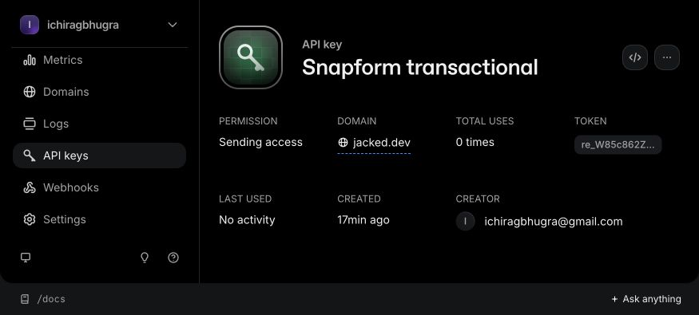

# Transactional authentication email

28 October 2026. The user approved a sending-only Resend key restricted to the existing verified `jacked.dev` domain, private local storage and auth test emails only to their own approved address. The browser confirms that scope; unrelated keys were not changed. The actual key is in ignored mode-0600 API configuration. The checked-in example contains dummy values.

Native `fetch` sends fixed-sender plain-text messages with a 10-second deadline and SHA-256-derived idempotency keys. Action links must stay on the configured origin and use auth paths. Local recipient enforcement happens before transmission. Provider response bodies and credential URLs are never reflected in errors or logs. No email SDK/template package was added. Five workerd tests cover success, recipient/origin rejection and sanitized provider/network failures.

Better Auth sends verification on signup, uses 15-minute verification/reset links, avoids automatic sign-in after verification and revokes sessions after a password reset. A real Neon integration test captures the external mail boundary, verifies the signed link, resets a password, rejects replay/old credentials and proves the old session was revoked. All writes roll back. Live email receipt and the browser account UI are the next gate; they have not yet been claimed complete.

The official `better-auth/minimal` entry excludes unused Kysely/database engines while retaining the Drizzle adapter. Real Node and workerd auth tests pass with it. Runtime public route changes are recorded separately.

Sources: [Better Auth email/password](https://better-auth.com/docs/authentication/email-password), [minimal initializer](https://better-auth.com/docs/installation), [Resend send API](https://resend.com/docs/api-reference/emails/send-email).
