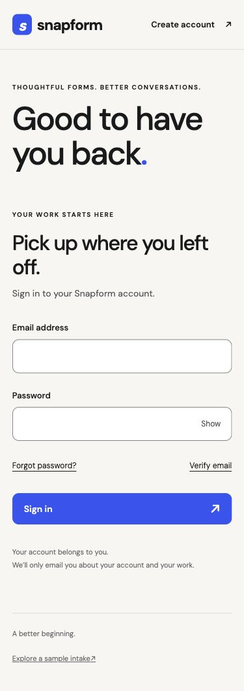

# Account screens and browser review

28 October 2026. Core email/password account screens now call the real Express/Better Auth/Neon boundary. Routes: `/signup`, `/verify-email`, `/login`, `/forgot-password`, `/reset-password` and `/app`. The sample intake at `/` still does not save responses. Workspace screens, invitations, MFA and optional Google sign-in remain subsequent increments; the market V1 is unfinished.

Native inputs and CSS use Foundation 0.2 typography/colors. TanStack Form handles field state, TanStack Query handles requests and TanStack Router handles navigation. No browser auth SDK, UI kit or animation dependency was added. Password values reset on success; returned session capabilities are not stored in application state. Initial SSR controls stay disabled until hydration so early input cannot be overwritten. Field errors are deduplicated and focus moves to the first invalid field or the completion heading. Motion respects reduced-motion preferences. Account pages opt out of indexing, and a native SVG favicon and font license are included. Vite retains warning/error logs while suppressing request-path info logs that could contain recovery capabilities.

## Actual browser evidence

- Normal user: created the owner's QA account, received the approved Resend email in Gmail, confirmed unverified sign-in was blocked, followed the real verification link, signed in, refreshed the authenticated page, signed out and confirmed protected content was unavailable afterward.
- Recovery: requested and received the real reset email, opened its reset form, then completed the credential change through the owned-app API at the user's request because they could not reach the laptop. Browser sign-in with the new private generated passphrase succeeded. The actual changed-password form submission was not performed through browser automation; this distinction remains part of the release evidence.
- Power user: keyboard email→password focus, password visibility/hide, repeated Enter submission (one persisted QA session), required-field focus and a tool-filled 97-character name beyond the native maximum. Inputs remained available for correction; no duplicate error text remained.
- Adversarial user: injection-shaped duplicate signup did not replace the verified account identity or render an image. Closed SDK session routes returned 404. A real invalid reset capability redirected to the visible request-new-link state. Automated workerd cases separately cover forged fields, body bounds, invalid JSON, origin/redirect rejection and rate limits.
- Production build: real sign-in/profile/reload/sign-out worked with CSP enabled; no unexpected browser console errors. Login layouts at 320, 375, 768, 1024 and 1440px had no horizontal overflow. Every visible interactive target in the checked mobile login was at least 44px high. Native CSS fixes also cover long account text and footer/recovery link targets.

All client chunks total 166.04 KiB gzip; CSS 3.29 KiB; primary font 36.07 KiB. These remain within 200/20/40 KiB budgets. Three warm local rejected-sign-in HTTP samples were 628/581/582ms. A browser sign-in took roughly 4s and profile reads 1.3–2.5s in the local production preview; this is a latency limitation to investigate in the hosted Worker/Neon slice, not a production SLO claim. No hosted deployment or CI run is claimed.

The live browser checks exposed the disconnect bug recorded in ADR-014, a hydration-input race, duplicated field messages and undersized link targets. The real-workerd disconnect regression first failed and then passed; 31 Worker tests, six identity database tests and three auth integration tests pass. All 43 brief/auth contract tests and 14 auth HTTP-client tests pass as well. Workspace isolation tests are recorded in the next increment. Unexpected HTTP 200 responses are rejected unless they match the documented auth success shape; the new false-success tests first failed. The checked-in CI configuration uses dummy mail credentials and never sends these live test emails.

The QA emails were sent only to the approved owner address. Credentials and verification/reset capabilities are not included in these artifacts.
