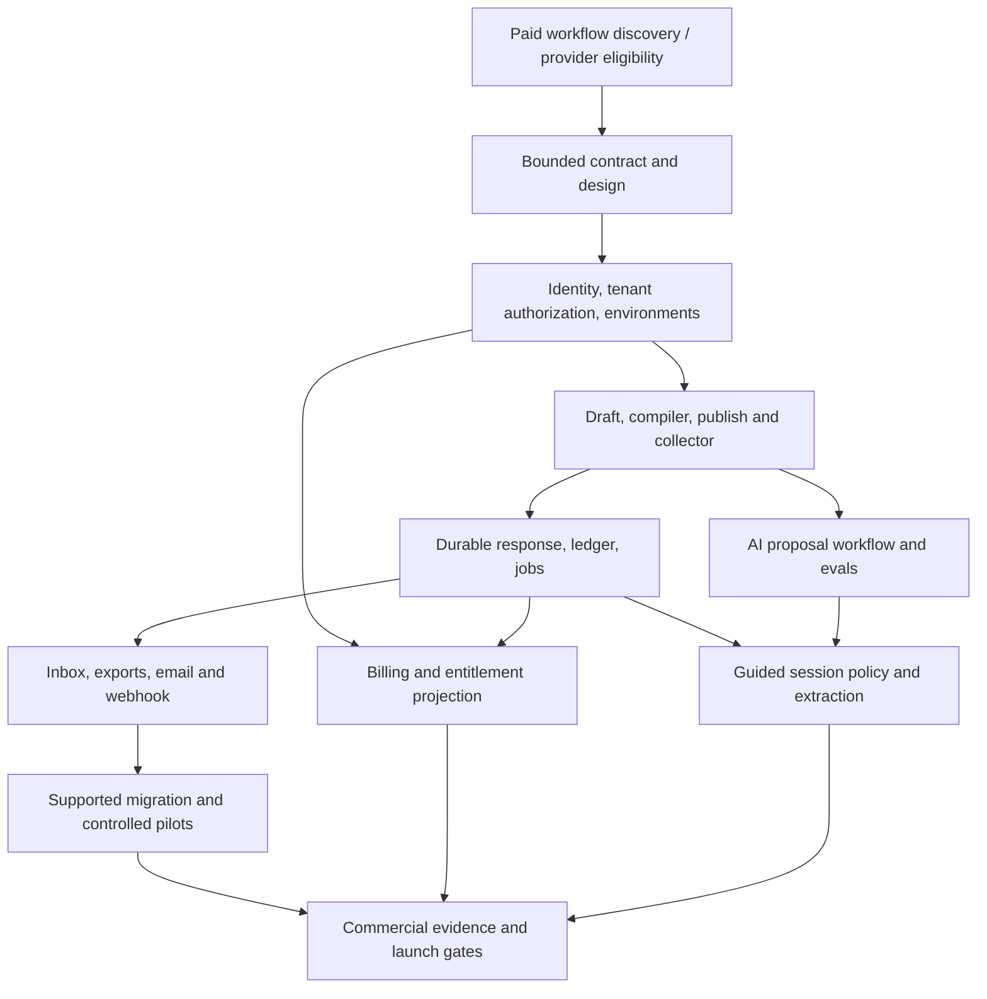

# V1 delivery plan and whole-product roadmap

**Status (29 October 2026):** Local verified accounts/workspaces, typed builder/rules, immutable publication APIs and the Neon-backed recoverable collector/durable submit are implemented and tested. Creator publication controls, files/delivery/inbox, billing/AI and hosted/market launch gates remain pending. Latest evidence: [collector verification](../docs/development/0041-durable-collector-browser.md). **Baseline:** solo founder, 30 focused engineering hours/week plus 5–10h business work; part-time design, QA/accessibility, security and legal/accounting support. Audience: agencies, coaches, consultants and small-to-medium startups. Source analysis and requirements are in `docs/`.

## 1. Development strategy

Build a usable deterministic intake path first, then add assisted authoring and guided completion over the same engine. Establish identity, tenancy, schema versions, deployment, usage reservations, audit boundaries, telemetry and recovery from the start. Add safeguards with the feature that creates the risk; the final phase verifies them rather than inventing them.

Every slice includes contract/schema change where needed, authorized API, UI, error states, meaningful verification and documentation. Keep the system usable at phase boundaries. No public launch depends on an unreviewed AI proposal, untested migration, unverified payment redirect or unacknowledged response.

## 2. Foundation dependency graph

Security, accessibility, observability and recovery run through every stage. A subscription entitlement projection is consumed by collection; collection does not synchronously call the billing provider.

## 3. Schedule and reviewable outputs

Estimates are judgment-based ranges with no historical delivery velocity. **Total 32–40 weeks / 960–1,200 founder engineering hours includes ~20% uncertainty reserve**, not 20% added again. Specialist hours and business work are separate. Re-estimate after discovery and the first end-to-end slice; do not treat phase windows as deadlines. No calendar launch date is committed. **28 October platform revision:** this previous estimate is provisional until the hosted TanStack/Cloudflare Workers/Neon/auth/outbox slice is proven. The local validation slice does not satisfy that gate. T65/T66 add explicit foundation verification; re-baseline P1 and the overall envelope after the spike, rather than treating the changed platform as free scope.

| Phase | Duration | Cumulative window | Deliverable / exit gate |
|---|---|---|---|
| P0 Commercial definition and feasibility | 2w | Weeks 1–2 | 12–16 interviews, sample briefs, three workflow-aligned pilot commitments, merchant/region/adapter feasibility, scope and owner decision |
| P1 Foundation and design | 3–4w | Weeks 3–6 | TanStack monorepo, Workers environments/CI with a separate gated native-scanner workload, Better Auth/Neon tenants, contracts, tokens, outbox/Queues, telemetry/backups; cross-tenant denial and deployment slice proven |
| P2 Deterministic vertical slice | 5–6w | Weeks 6–12 | Creator edits five fields/conditional path, versions publish, mobile collector reviews/submits once, durable event/usage/outbox survives retry and queue-publication failure |
| P3 Usable intake and handoff | 4–5w | Weeks 11–17 | Full V1 field subset, safe files, results/export, email/webhook/recovery, basic analytics, branding/embed; invited operational pilot |
| P4 Migration and commercial lifecycle | 4–5w | Weeks 15–22 | Supported Typeform import/report, cutover plan, checkout/cancel/dunning/quotas, retention/delete, role/support flows; paid pilot possible |
| P5 AI authoring | 5–6w | Weeks 19–28 | Brief-to-draft and typed edits, dependency diff, business-fact review, undo/stale job control; held-out authoring evaluation passes |
| P6 Guided intake | 5–6w | Weeks 24–34 | Approved FAQ text, extraction evidence, corrections/review, limits/cost reservations and outage fallback; AI gates pass |
| P7 Pilot evidence and launch hardening | 4–6w | Weeks 29–40 | Paid repeat-use evidence, accessibility/security/load/restore reports, support/legal/billing readiness, staged release and rollback |

The cumulative windows express earliest phase start through latest phase end, not overlapping commitments for a solo builder. At the low-duration case boundaries are P0 1–2, P1 3–5, P2 6–10, P3 11–14, P4 15–18, P5 19–23, P6 24–28, P7 29–32; high-duration case ends at week 40. Commercial interviews and safe pilot observation continue while engineering proceeds.

**Earlier learning:** manually demonstrate the specimen during P0/P1; run the five-field deterministic slice in an invited pilot after P2/P3. These are controlled milestones, not the planned market V1. Reuse pilot evidence; no need to wait for every AI feature before learning if the intake workflow matters.

**With more people:** two engineers plus a part-time designer/QA specialist may reduce delivery toward roughly 18–24 weeks, subject to shared-contract coordination and unchanged observation gates. This is a scenario, not a linear divide-by-team-size estimate. An extra engineer does not shorten payment onboarding, customer retention observation or independent security review automatically.

## 4. Checkpoints

### CP0 — Scope before substantial construction

- Workflow, buyer, sample fields and demanded destination fit a shared product.
- Region/selling entity, existing Razorpay account Subscription configuration/currency/market coverage, Cloudflare Worker/native-scanner feasibility and source adapter are recorded.
- V1 inclusions, exclusions, capacity and claims approved as a concrete baseline.
- Design specimen is reviewed with target users; revise assumptions, not just colors.

### CP1 — Foundation

- New user can create workspace; second tenant cannot read/write/export its records.
- CI builds all deployments; secrets and environment data are separated.
- Deployed Start/ingress/Express Worker/Neon/auth/R2 slice passes lifecycle, cookie and transaction checks; runtime constraints and release blockers recorded.
- Outbox/Cloudflare queue relay survives duplicate dispatch, lease expiry and transport failure before dependent collection work expands.
- Backup configuration and recovery ownership exist; initial restore test planned/executable.
- Static request contracts and bounded form DSL are documented.

### CP2 — First end-to-end correctness

- Five-field mobile form, conditional section, revision/publish, final review and durable record work.
- Refresh, double-submit, stale edits, upstream path changes, worker restart and post-commit timeout are exercised.
- The same test cases give identical preview and server outcomes.
- Response/event/usage/outbox writes are atomic; Cloudflare queue dispatch is recoverable after commit, and no duplicate delivery or retry bills twice.

### CP3 — Operational pilot

- Representative real briefs arrive with correct effective fields and a delivery receipt.
- Files stay quarantined/private; exports and notifications do not leak sensitive data.
- Destination failures are visible and repairable; unknown external outcomes do not prompt blind duplication.
- Support observes a user finding/repairing an issue unaided.

### CP4 — Paid pilot

- Import compatibility and rollback reviewed for every migrated pilot form.
- Billing lifecycle, limits, cancellation and owner read/export grace work.
- Privacy/retention, provider data paths and limited support access match customer notices.
- Five paid workspaces is the target entering public-launch evaluation; discovery may require repositioning first.

### CP5 / CP6 — AI release

- Authoring evals and compiler gates pass before proposal rollout.
- Guided extraction/grounding tests, direct correction, critical confirmation and fallback pass.
- Model/prompt/version and token/spend accounting reconcile; kill switch rehearsed.
- AI business facts require approval, and no conversational command can alter authority.

### CP7 — Public release

- All P0 requirements, NFR evidence, restore/security/accessibility reports and business gates complete.
- No unresolved critical/high findings; any accepted lesser risk has owner/date/mitigation.
- Accurate help/limits/legal/trust materials, merchant access, normal support and urgent alert coverage exist.
- Founder records go/no-go; invite next cohort, observe, then widen access. No unbounded launch-day traffic.

## 5. Backlog usage and definition of done

Ordered implementation units and dependency IDs are in `tasks/todo.md`. Original backlog paths are **proposed**; map them to the implemented workspace before starting each remaining unit. Each task targets a small set of files and has acceptance and verification; split any task whose implementation grows beyond ~5 files or one focused session. Parent phase estimates include integration, defects, polishing and contingency; task IDs are not hour estimates.

Definition of done: intended behavior and failure behavior demonstrated, no tenant/privacy regression, relevant automated checks, keyboard/mobile states where touched, safe migration/rollback, updated docs/telemetry and no secrets. Do not make passing checks meaningless with skips/suppressions. Capture build/model/data-fixture versions in evidence. Reversible documentation changes need editorial/link checks, not artificial unit tests.

Recommended routine: choose one unblocked unit → confirm contract/acceptance → implement thin slice → verify → review diff → update evidence and task status. Review checkpoint outcomes before changing phase. A failed commercial gate can stop feature expansion even if engineering is on schedule.

## 6. Full-product roadmap

Relative horizons are **after market V1** and conditional on staffing, demand, margins and reliability. No credible solo plan can promise full Typeform + Jotform + Formless parity to a fixed date.

| Horizon | Product outcome and candidate work | Business/technical entry gate |
|---|---|---|
| V1.1, ~0–3 months | Improve activation/retention: first demanded native CRM/Sheets connector; second source importer; better consultant/coach/startup templates; explicit save/resume links | Recurring paid blocker, stable core SLO, security/connector lifecycle tests and support capacity |
| V1.5, ~3–6 months | Better brand/collection: custom domains, approved translation workflow, reusable themes, repeaters, simple deterministic scoring/calculations | Retained cohort demonstrates demand; schema/version compatibility; locale-specific evaluation; price supports complexity |
| V2, ~6–12 months | One adjacent workflow: booking OR provider payments OR document signing/approval; richer approved knowledge and evidence-linked qualitative summaries | Choose by retained revenue opportunity; provider eligibility, reconciliation, data governance, positive unit economics |
| V2.x, ~12–18 months | Team operations: reusable rule libraries, API/SDK, deeper destinations and bounded automation; more granular permissions | Repeated cross-customer workflow, integration support staffing, versioned public contracts |
| V3/enterprise, ~18–24+ months | SSO/SCIM, audit export, contractual service levels/residency options, advanced administration; selected offline/voice vertical product if warranted | Multiple committed enterprise buyers fund security/ops/contracts; independent assurance program and sustained support coverage |

Bookings, payments, signing, voice and offline are independent product bets with their own support costs. Do not schedule all of them simultaneously. Advanced research capabilities require fixed-question measurement controls, method expertise and a separate market case. A form renderer does not provide a valid research platform automatically.

## 7. Risk register

| Risk | Early signal | Owner / response |
|---|---|---|
| Four segments dilute focus | Every pilot requests a different workflow | Founder: choose a repeatable shared job; templates before engines |
| Weak paid demand | Praise but no live cutover/payment | Founder: test paid pilot; reposition before AI expansion |
| Migration scope explodes | Widgets/complex rules dominate imported forms | Founder: compatibility report, supported subset and assisted reconstruction; no silent flattening |
| Conversation adds friction | Lower completion/higher time with little rework benefit | Product: standard default, tighter prompts/limits; keep pilot or rescope explicitly |
| AI states look correct but aren't | Critical correction/unsupported claim | Engineering + reviewer: evidence/confirmation and eval gate, kill switch |
| Delivery creates duplicates | Timeout after remote success | Engineering: unknown state, destination idempotency/reconciliation, clear receiver contract |
| Tenant/data exposure | Missing scope in job/export/file query | Security reviewer: non-owner role/RLS, negative matrix and scoped support |
| Provider/billing access blocked | Merchant onboarding/region fails | Founder: P0 eligibility spike, approved alternative before checkout work |
| Solo availability | Unanswered urgent alerts | Founder: backup operator/runbooks, no unsupported contractual SLA |
| Margin/support failure | High support minutes, model escalation or spam spend | Founder: bounded plan, reservations, usage cohorts, charge for manual setup |
| Schedule optimism | Two slices materially exceed estimates | Founder: reforecast scope/date with evidence; no reliability cuts |
| Recovery gap | DB restores but attachments missing | Engineering: object manifests/copies and timed combined restore |

## 8. First ten working days

1. Recruit/observe users in all four segments and collect permissioned example briefs.
2. Pick the first repeated paid workflow and destination; list disqualifying requirements.
3. Resolve selling-entity/payment access and provisional data geography.
4. Run a source import feasibility spike and compare a licensed form component against the bounded custom approach if useful.
5. Walk the visual specimen and field-review flow with operators/respondents.
6. Freeze a reviewable V1 contract, load profile and privacy/retention assumptions.
7. Create the product scaffold and tenant-isolation tests only after scope review; implementation is the next workstream, not performed here.
